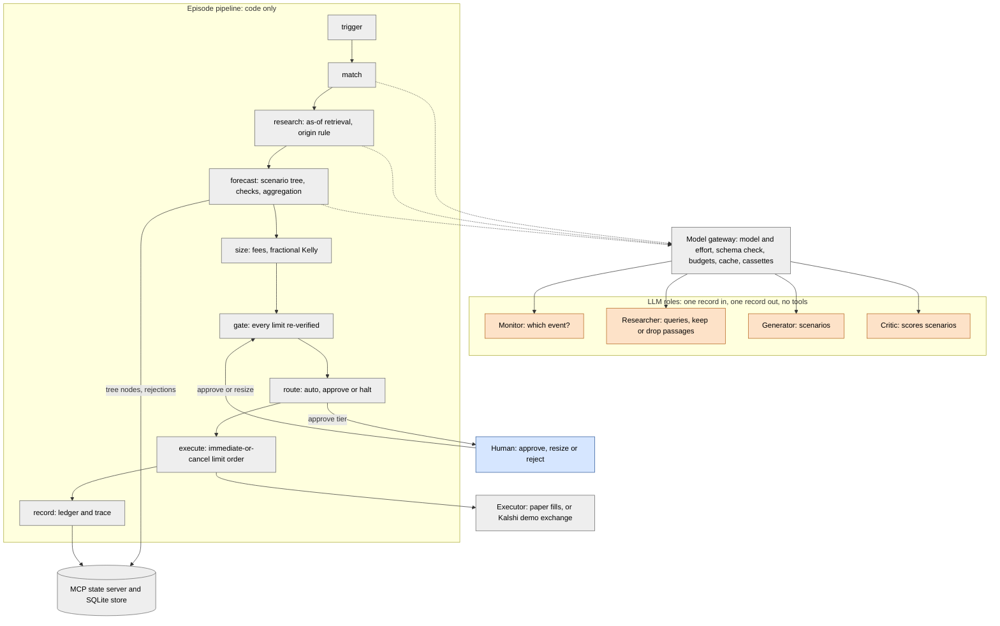

# pmfa: a prediction-market forecasting agent

[](https://github.com/youngminpark14/CMU-Capstone-Project/actions/workflows/ci.yml)

pmfa forecasts Kalshi prediction markets on U.S. economic releases (Federal Reserve rate decisions
and monthly CPI) and sizes positions on them. When a new official document appears or a price
moves, it matches the trigger to the event it affects, reads the event's rules, retrieves evidence
published before that moment, builds one probability for every market of the event from a search
over alternative scenarios, compares that forecast with the market price after fees, sizes an order
with fractional Kelly, checks it against hard limits in code, and either places an
immediate-or-cancel limit order or asks a human to approve it. Every step is recorded so any
decision can be replayed. Terms such as *episode*, *as-of time* and *origin* are defined in the
[glossary](docs/glossary.md).

What it does not do: it never trades real money and has no way to place an order on Kalshi's
production exchange; the only orders it can send go to Kalshi's demo exchange, which uses mock
funds. Nothing here is investment or trading advice.

### Status

| Area | State |
| --- | --- |
| Pipeline and tests | Built end to end. The offline suite of 1,196 tests runs with no keys and no network in about two and a half minutes on one machine (1,192 passed in 146 seconds on 2026-11-26). Four tests are skipped by default: the three [opt-in smoke tests](#opt-in-smoke-tests), and a test that needs a locally cached embedding model. |
| Episode scenarios | All sixteen scenarios from the specification pass in [tests/episodes/test_scenarios.py](tests/episodes/test_scenarios.py). |
| Offline replay | Five sample episodes replay with one command and match their committed outputs. |
| Real data | The exchange snapshot (7 settled events, 104 markets) and the evidence corpus (45 Federal Reserve and 10 BLS documents) were built from the live public sources on 2026-11-25. The counts are in the published [manifest](evaluation/runs/2026-11-26-market-baseline/manifest.json). The whole backtest has been rehearsed on this data with fixed-rule role answers in place of a model ([scripts/rehearse_backtest.py](scripts/rehearse_backtest.py)), which checks the data and the pipeline around the models but not the model side (the gateway, the cache, the dollar caps): its forecasts mean nothing. |
| Measured | Of forecasting, only the market's own: its Brier score and calibration error (see [Results](#results)). They are the baseline every later run is compared with. The other measured figures here, such as fill coverage, price staleness and build time, describe the data and the harness, not forecasting. |
| Not yet done | **No live model call has been made in this repository**, because no Anthropic API key was available. The agent's forecasts have therefore not been measured. |
| Sample episodes | Hand-made fixtures: the inputs are real, but every model record is fixed text written in advance with an AI coding assistant, not the output of the pipeline's roles. They show the pipeline working, not forecasting skill, and each one says so. |
| Shadow mode | Exercised for plumbing only, against recorded worlds in [tests/live/](tests/live/). |
| Demo executor | Built from Kalshi's documentation and tested against recorded and constructed responses, not against a live demo account. |
| Fees | The fee formula and rounding are tested on hand-computed cases and one worked example from Kalshi's fee-rounding documentation. The fee schedule PDF's own worked examples are not in the tests: the PDF sits behind a browser check. |

Beating the market price is the hypothesis the evaluation tests, not a result of this project.

## Architecture

One pipeline, the *episode*, runs for each trigger. Four LLM roles read and judge; they return
records and cannot call tools. Code does everything else: every retrieval, check, number that
touches money, and order.



Every step can also end the episode early in a named *exit* (`no_match`, `no_evidence`,
`insufficient_origins`, `no_edge`, `gate_rejected` and others); most episodes end without a trade.
The full diagrams, the scenario tree search, a worked example and how to read a trace are in
[docs/architecture.md](docs/architecture.md).

## Review in ten minutes

Nothing to install.

1. **One sample episode.** Open [examples/inputs-and-outputs.md](examples/inputs-and-outputs.md),
   then [examples/episodes/fed-minutes-hawkish/](examples/episodes/fed-minutes-hawkish/): its
   README, `world.json` (inputs) and `expected/episode.json` (outputs). Look for: the trace as
   thought, action and observation steps, where thoughts are the only lines a model wrote; the
   passage ids each scenario cites, with source, URL and publish time; and the notice that the model
   records are hand-written.
2. **The guardrail table.** [docs/guardrails.md](docs/guardrails.md) lists every guardrail, whether
   code, the exchange or a human enforces it, and the test that shows it.
3. **The sixteen scenario tests.** [tests/episodes/test_scenarios.py](tests/episodes/test_scenarios.py):
   `test_01` to `test_16` run whole episodes against fixed worlds and assert what was decided (exit,
   forecast, proposal, routing tier, orders), for example that a halted agent sends no order in any
   mode and that a canary document dated after the as-of time is never retrieved.
4. **The evaluation report.** [evaluation/runs/2026-11-26-market-baseline/report.md](evaluation/runs/2026-11-26-market-baseline/report.md).
   Look for: the table of which systems ran and which did not, sample sizes by event as well as by
   market, and the section on how look-ahead was prevented.
5. **The decision records.** [docs/decisions/README.md](docs/decisions/README.md): 43 short
   records, each with its reasons and where it came from: a capstone checkpoint where the
   specification names one, otherwise the item of the specification or the build.

## Replay an episode offline

No account, no key, no network. With [uv](https://docs.astral.sh/uv/) and Python 3.12:

```bash
uv sync
```

```bash
uv run pmfa replay examples/episodes/fed-minutes-hawkish
```

It prints the hand-made-fixture notice first, then the trigger and as-of time, the numbered trace
(thought, action, observation), the forecast for each market next to the market price no role saw
(marked `*` where that price is the last trade because one side of the quote was empty), the
proposal, all nineteen gate checks, the routing tier, the review card, the simulated order and
its fill, and the exit. `--check` compares the replay with the committed `expected/` files and exits
non-zero on any difference; `--verbose` prints each step's records; `--json` prints the episode
record.

The other four examples:

- [examples/episodes/phantom-edge-no-trade/](examples/episodes/phantom-edge-no-trade/): a hot CPI report the market had already priced; exit `no_edge`.
- [examples/episodes/review-resize/](examples/episodes/review-resize/): a reviewer shrinks an approve-tier proposal; the gate runs again and the smaller order fills.
- [examples/episodes/cpi-ladder/](examples/episodes/cpi-ladder/): one forecast gives monotone probabilities across real CPI strikes; no strike meets the liquidity floor, so `no_edge`.
- [examples/episodes/single-origin-syndicated/](examples/episodes/single-origin-syndicated/): one invented story syndicated twice counts as one secondary origin; exit `insufficient_origins`.

`uv run pmfa replay --list` lists them. The sample episodes also ship inside the package's wheel, so
`pmfa replay --list` works after an install outside this checkout.
[examples/README.md](examples/README.md) describes the files and where each input came from.

## Setup

Python 3.12 and uv. `uv sync` installs the default environment (see
[Dependencies](#dependencies-and-the-two-environments)). Secrets are read only from the process
environment: export each variable you use in the shell that runs `pmfa` (for example
`export ANTHROPIC_API_KEY=...`). Nothing reads a `.env` file, not even CrewAI, whose own `.env`
loading is switched off; nothing logs or stores a key; and git ignores `.env` and key files.
[.env.example](.env.example) lists every variable the code reads, as a list to copy from.

### No keys: replay and the test suite

```bash
uv run pmfa replay fed-minutes-hawkish
```

```bash
uv run pytest
```

The suite is offline and deterministic. On every push and pull request CI runs `ruff check`,
`ruff format --check` and the suite in the default environment, and the suite alone in the MCP SDK
2.x environment ([ci.yml](.github/workflows/ci.yml)).

### An Anthropic API key: rebuild the data, backtest, shadow mode

```bash
export ANTHROPIC_API_KEY=...
```

Rebuild the frozen data first. This step reads public Kalshi market data and Federal Reserve and BLS
pages and needs no key. The snapshot build is resumable: after an interruption, run it again and it
continues with the first market it had not finished.

```bash
uv run pmfa data build
```

To check a rebuilt snapshot against the published run, compare the content SHA-256 that
`pmfa data build` prints with `snapshot_content_sha256` in the run's
[manifest](evaluation/runs/2026-11-26-market-baseline/manifest.json); the file's own hash differs on
every rebuild. The digest covers the snapshot only, not the corpus. Both end their window at the
build time unless `pmfa data build --end YYYY-MM-DD` ends it earlier, so a later rebuild can hold
more: an event that has closed since, or a document published since
([The frozen data](docs/evaluation.md#the-frozen-data)). A rebuild from scratch on 2026-11-25 took
1,532 seconds (about 25 minutes), 1,408 of them for the snapshot at two requests per second.

BLS pages may refuse automated clients. When a release is not fetched, save it from a browser into
`data/manual/` as `bls-cpi-YYYY-MM.html` (the reference month, for example `bls-cpi-2026-10.html` for
the October CPI) and run `pmfa data build` again. The steps are in the docstring of
[bls.py](src/pmfa/world/evidence/bls.py).

Before any paid run, rehearse the whole backtest. It needs no key and costs nothing:

```bash
uv run python scripts/rehearse_backtest.py
```

It runs every system at every scoring point and the pipeline at every news trigger over the frozen
data, with a fixed rule in place of every model answer. It builds the retrieval indexes, sizes and
gates orders against real books, fills them from real candles, applies the stops, saves traces and
replays each one, and writes a report to `runs/<date>-rehearsal` (ignored by git). It takes about a
minute. It exits non-zero, with a `PROBLEM:` line for each failed check, unless the run completed,
episodes got past matching in both passes, no pipeline episode ended `rules_mismatch`,
`low_coverage` or `error` (a refused answer or a failed step), the pipeline made forecasts and sent
at least one order, and at least one trace was saved and every saved trace replays and matches. Its
forecasts come from fixed rules and mean nothing. It checks the data and the pipeline around the
models on the paths its fixed answers take. It does not reach the model side: the gateway's
structured-output schemas, the response cache, cassette recording, the role runners and the dollar
caps (the per-episode call cap still applies). Its critic always scores, so critic rejections and
evidence follow-ups never run. `pmfa report --publish` refuses to publish it.

Then plan the backtest. The dry run prints the model calls and the dollar estimate per system and
calls no model; the order in which to run the real backtest (a subsample first, then the full run)
and what each step costs are in
[docs/evaluation.md](docs/evaluation.md#running-the-systems-that-need-a-model). Without the key,
`pmfa backtest` still runs and scores the market alone.

```bash
uv run pmfa backtest --dry-run
```

Shadow mode runs one pass on live Kalshi prices and live Federal Reserve and BLS listings, and
records the trades it would make on paper:

```bash
uv run pmfa shadow
```

### A Kalshi demo key: approved orders on the demo exchange

Create an API key on Kalshi's demo exchange (mock funds), restricted to one numbered subaccount
(default 1, `kalshi.demo_subaccount`). Then:

```bash
export KALSHI_DEMO_KEY_ID=...
export KALSHI_DEMO_PRIVATE_KEY_PATH=/path/to/demo-key.pem
```

`KALSHI_DEMO_PRIVATE_KEY` can hold the PEM text instead of a path. Demo mode also needs
`ANTHROPIC_API_KEY`.

```bash
uv run pmfa demo
```

Demo mode always runs at the approval stage, whatever stage is stored, so every demo order waits for
you: `pmfa review list --mode demo`, then approve, resize or reject. Approval runs the gate again at
the current price before the order is sent.

Export only the variables you use; an empty `PMFA_CONFIG` counts as not set.

### Opt-in smoke tests

Three tests call live services and are skipped unless `PMFA_SMOKE=1` is set:

```bash
PMFA_SMOKE=1 uv run pytest -m smoke
```

- one read of a series from Kalshi production (public data, no key);
- a read-only check of the demo exchange: the balance and one market, no order. It needs
  `KALSHI_DEMO_KEY_ID` and `KALSHI_DEMO_PRIVATE_KEY` or `KALSHI_DEMO_PRIVATE_KEY_PATH`;
- one model call through the gateway on the cheapest configured model. It needs
  `ANTHROPIC_API_KEY`.

A test whose keys are missing is skipped. CI never sets `PMFA_SMOKE`.

## Run modes

The pipeline code is identical in every mode; only what sits behind its ports changes.

| Mode | Exchange | Evidence | Models | Orders | Command |
| --- | --- | --- | --- | --- | --- |
| Replay | One recorded file | Recorded documents and retrieval calls | Cassettes (recorded model records) | Simulated | `pmfa replay NAME` |
| Backtest | Frozen snapshot, read as of each forecast time | Frozen corpus, read as of each forecast time | Claude API, cached | Simulated from candles | `pmfa backtest` |
| Shadow | Kalshi production, public data only, no credentials | Live Federal Reserve and BLS listings | Claude API | Simulated against the live order book | `pmfa shadow` |
| Demo | Kalshi demo exchange | Live Federal Reserve and BLS listings | Claude API | Real orders on the demo exchange, mock funds, human approval | `pmfa demo` |

`pmfa shadow` and `pmfa demo` run one pass by default; `--loop` repeats every `--interval` seconds
(default 300) until Ctrl-C. In shadow mode approve-tier proposals are filled on paper and tagged;
`pmfa shadow --review` pauses them for you instead. Demo P&L is never reported as evidence: Kalshi
warns that demo prices may not reflect real markets.

In a backtest, every decision (sizing, the price re-read before sending, the recompute when
nothing is offered at the limit, the gate and routing) reads the market as of the as-of time. Only
the fill is priced later, from the candle that holds the order's arrival 60 seconds after the as-of
time: the one-minute candle, else the hourly one, else nothing fills. The order's outcome, filled
or not, is timed at the end of that candle; an hour after the arrival time (the end of the hour
searched) when there is none; or at the arrival time when the market had closed by then. The paper
account, the equity points and the stops that read orders (fill failures, a changed source) count
the order only from that time, so an order that did not fill counts toward the fill-failure stop
from then too. The next trading episode starts no earlier than that time, and one that starts after
its trigger takes the later time as its as-of time.

## Commands

`uv run pmfa --help` and `uv run pmfa COMMAND --help` show every option.

| Command | What it does |
| --- | --- |
| `pmfa replay` | Replay a recorded episode offline and print its trace (`--list`, `--check`, `--verbose`, `--json`). |
| `pmfa trace` | Print a stored episode's trace from a state database. |
| `pmfa data build` | Rebuild the evidence corpus and the exchange snapshot for the backtest window. |
| `pmfa data status` | Print the corpus and snapshot manifests. |
| `pmfa backtest` | Score the systems on the frozen snapshot and simulate news-triggered trading (`--dry-run`, `--limit`, `--systems`, `--cap`, `--no-trade`, `--no-score`, `--run-name`, `--config`). |
| `pmfa report` | Build `report.md` and figures for a run directory; `--publish NAME` copies it to `evaluation/runs/NAME`, and refuses a run answered by supplied models (scripted answers or a rehearsal). |
| `pmfa shadow` | Shadow mode: live data, simulated fills, no orders. |
| `pmfa demo` | Demo mode: Kalshi's demo exchange, mock funds, every order needs approval. |
| `pmfa review` | `list`, `show`, `approve`, `resize` and `reject` proposals that wait for you. |
| `pmfa halt` | Set the persisted halt flag and cancel all open orders. With no `--mode` it halts every live mode (shadow and demo); `--mode` narrows it to one; `--status`, `--resume`. |
| `pmfa stage` | `status`, `advance` and `demote` the autonomy stage; `advance` refuses unless the benchmark is met. `status` and `advance` take `--from-run RUN_DIR` (repeatable) to count a backtest run's scored forecasts. |
| `pmfa state-server` | Serve a state database over MCP on stdio, for browsing episodes with any MCP client. |
| `pmfa resolve` | Run the outcome resolver once and print what resolved. |
| `pmfa config` | `show` the effective configuration, or `check` a file. |
| `pmfa report-status` | Print the monitoring report: P&L, drawdown, exits, rejections, fills, overrides, calibration. |

## Configuration

[pmfa.toml](pmfa.toml) holds every limit, threshold, source, model assignment and followed series,
with comments. It is the built-in defaults as `pmfa config show` writes them, and a test keeps the
two equal, so leave it unchanged. To change a value, write a TOML file with only the keys you change
(defaults fill in the rest), check it, and point `PMFA_CONFIG` at it. That file then replaces
`pmfa.toml`; it is not layered on top of it.

```bash
uv run pmfa config check my-config.toml
```

```bash
export PMFA_CONFIG=my-config.toml
```

`pmfa backtest` also takes `--config FILE` and `--cap DOLLARS`. The configuration refuses to load
when caps contradict each other, for example a per-order cap at or above the exchange order group's
50-contract limit.

`sources.feeds` lists RSS or Atom feed URLs that shadow and demo mode poll as secondary evidence. It
is empty by default, so nothing is fetched from a feed unless you list one. A feed on the host of a
primary source (`federalreserve.gov`, `bls.gov`) is refused, so a feed item never counts as a
primary origin. Backtests do not read feeds.

The most important defaults:

| Setting | Default |
| --- | --- |
| Followed series | `KXFEDDECISION` (Fed decision), `KXCPIYOY` (CPI year over year) |
| Kelly fraction | 0.25 (quarter-Kelly), multiplied by forecast confidence |
| Shrinkage toward the market price | 0.5 |
| Minimum edge after fees | $0.02 per contract |
| Caps | 25 contracts per order; 5% of bankroll per market; 10% per event |
| Stops | Daily loss stop 3% of the day's starting equity; drawdown halt 10% below peak equity; both count unrealized losses |
| Liquidity floor | $500 resting within $0.02 of the touch |
| Notional bankroll (backtest, shadow) | $1,000 |
| Proposal expiry | 10 minutes |
| Budget per episode | 30 model calls, $2.00, and in live modes 90 seconds spent waiting on model calls (other steps are not timed) |
| Budget per run | $25.00 |
| Backtest window start | 2026-07-01 |

## Guardrails

Models read and judge; code acts. The main guardrails:

| Guardrail | Enforced by |
| --- | --- |
| Roles have no tools: one validated record in, one out | Code |
| Evidence text reaches a model only inside delimited blocks, as data | Code |
| No role sees the price of the market it forecasts | Code |
| Nothing published or priced after the as-of time is read, except the candle that prices a backtest fill | Code |
| A backtest fill counts only from the end of that candle | Code |
| A trade needs one primary origin or two independent secondary origins | Code |
| The gate re-verifies every cap, the edge and the limit price, and never changes an order | Code |
| Limit orders only, immediate-or-cancel only | Code |
| The halt flag blocks every order in every mode, and is read again immediately before an order is sent; `pmfa halt` with no `--mode` halts every live mode | Code |
| The agent halts itself on the daily loss stop and the drawdown halt (both count unrealized losses), on fill failures, on a changed or withdrawn source, and on calibration error that stays high for two weeks | Code |
| An episode continued after a crash or an exchange error only looks its order up by its client order id; it never places one | Code |
| The production exchange adapter has no order methods and loads no credentials | Code |
| A trade goes to a human unless every auto condition holds at the autonomous stage | Code, then human |
| Approve, resize smaller, or reject with a reason code | Human, checked by code |
| The demo key is restricted to one subaccount and cannot transfer funds | Exchange |
| More than 50 contracts in 15 seconds cancels the order group's orders | Exchange |
| Calls, dollars and seconds are capped per episode, dollars per run; a call whose worst-case cost would pass a dollar cap is refused before it is sent | Code |

The full table, with the file that enforces each guardrail and the test that shows it, and what is
not guaranteed, is in [docs/guardrails.md](docs/guardrails.md).

## Results

One backtest has been run and published:
[evaluation/runs/2026-11-26-market-baseline/](evaluation/runs/2026-11-26-market-baseline/report.md).
It scored only the market's own price at 7, 3 and 1 days before each event's close, because the
systems that need a model could not run without an API key (the run requested the market alone, so
its report lists the others as "not requested"). The market's price is the YES mid when both sides
are quoted, else the last trade clamped into the standing quote. These numbers are not
the agent's. They are the bar any later system has to clear: Brier skill is
1 − system Brier ÷ market Brier on the same rows.

<!-- results-table:start (tests/docs/test_readme.py checks these numbers against metrics.json) -->
| Horizon | Forecasts | Markets | Events | Market Brier score | 95% interval |
| --- | --- | --- | --- | --- | --- |
| all | 312 | 104 | 7 | 0.0345 | 0.0107 to 0.0775 |
| 7d | 104 | 104 | 7 | 0.0376 | 0.0116 to 0.0799 |
| 3d | 104 | 104 | 7 | 0.0330 | 0.0091 to 0.0759 |
| 1d | 104 | 104 | 7 | 0.0329 | 0.0095 to 0.0760 |
<!-- results-table:end -->

The Brier score is the mean squared error of a probability against the 0-or-1 outcome; lower is
better. Intervals come from 2,000 bootstrap resamples of whole events. Seven events are the
independent observations, not 104 markets, so the intervals are wide. Of the market's summed
squared error over the 312 rows, the 185 rows priced below 0.10 carry 0.5%, the 45 rows from 0.10
to 0.90 carry 45.6%, and the 82 rows above 0.90 carry 53.9%. One event, KXCPIYOY-26JUN, carries
69.5%, and two of its markets carry 26.9% (T3.5) and 26.5% (T3.6): both were priced 0.975 to 0.99
at all three horizons and resolved NO. So the market's score on this sample rests mostly on one
release that surprised it
([Where the error comes from](evaluation/runs/2026-11-26-market-baseline/report.md#where-the-error-comes-from)).
The market's expected calibration error over all horizons is 0.0559. Prompt-only, single-pass and
the full pipeline were not run, and there is no simulated P&L. The window holds no event for the
October 2026 CPI release: the exchange listed no KXCPIYOY event for it.

Look-ahead is prevented inside the ports, not by the caller: every exchange read and retrieval
filters on the as-of time inside the call; a canary document dated after the window sits in the
retrieval index and aborts the run if any query returns it; the backtest world has no web access;
and a run refuses to start if any assigned model's knowledge cutoff falls on or after the window
start. The published run is market-only: it built no retrieval index and made no retrieval
(`leakage_checks` in its [manifest](evaluation/runs/2026-11-26-market-baseline/manifest.json)), so
the canary guarded nothing in that run; there the as-of rule applied to the snapshot's price reads.
The tests exercise the canary, for example
[tests/evaluation/backtest/test_backtest.py](tests/evaluation/backtest/test_backtest.py), where a
canary in a retrieval result aborts the run. Method and controls:
[docs/evaluation.md](docs/evaluation.md). The notebook
[notebooks/evaluation.ipynb](notebooks/evaluation.ipynb) rebuilds the report's main tables (Brier
score and skill, reliability) and its three figures from the committed `forecasts.csv` and
`metrics.json`, and stops if a number differs from `metrics.json`.

## Limitations

- **The agent's forecasting has not been measured.** No live model call has been made here; the only
  forecasting result measured is the market's own (its Brier score and calibration error).
- **The sample is small.** The window from 2026-07-01 holds 7 settled events in the two followed
  series. No result on it can separate skill from luck; the harness is the deliverable and its numbers
  are a pilot.
- **Many backtest prices are old trades.** Prices come from candles, which exist only when a quote
  or trade changed. 226 of the 312 scored prices had one side of the quote empty and used the last
  trade, whose median age was 60.5 hours. Across all 312, the standing quote had last changed a
  median of 0.45 hours before.
- **Backtest fills are simulated from candles.** Kalshi's history has no order-book depth, so
  liquidity is a candle-volume proxy, and a fill falls back to the hourly candle when no one-minute
  candle covers its arrival time.
- **A backtest's trading simulation is likely to halt itself early.** It applies the same stops as
  the live modes, nobody resumes a halt in a backtest, and the report says when and why each pass
  halted. Two stops are likely to trip in the trading pass. On the frozen data,
  [scripts/fill_coverage.py](scripts/fill_coverage.py) finds that of the 204 market sides that pass
  the liquidity floor at the 55 news triggers, 86 (42%) had no contracts at any price in the candle
  an order would meet, and 131 (64%) none at or below the as-of ask, which is the limit a backtest
  order carries, while the fill-failure stop trips when two or more of the last ten orders did not
  fill, once ten orders exist (`oversight.fill_failure_window = 0` turns that stop off). The
  calibration stop trips for a category when the expected calibration error of the pipeline's
  resolved forecasts stays above 0.10 for two weeks, with at least 30 resolved market forecasts at
  each weekly check; one CPI release (21 or 26 markets) forecast twice is enough. The market's own
  prices for the window's first CPI release (the June 2026 CPI, closed 2026-07-14) have an expected
  calibration error of 0.140, so an agent no better calibrated on it would stop trading about two
  weeks later, near the end of July. The scoring pass settles nothing until the run ends, so its
  calibration stop has nothing resolved to read and cannot trip. A halt leaves the Brier scores
  unchanged, because the forecast comes before the gate, and `pmfa backtest --no-trade` runs the
  scoring alone. No backtest with model forecasts has run yet, so these are expectations from the
  data, not results ([Fill assumptions and their
  limits](docs/evaluation.md#fill-assumptions-and-their-limits)).
- **Sample episodes are hand-made.** Their model records are fixed text written in advance, with an
  AI coding assistant and with the outcomes known. They are not the output of the pipeline's roles.
- **Exchange-side protections are documented, not verified.** The subaccount restriction, the
  funds-transfer block and the order-group breaker have not been exercised against a live demo
  account.
- **An injected passage can still distort a probability**, within the caps; roles cannot act on it.
- **Evidence is official sources only**: Federal Reserve and BLS. No news wires or web search. A
  generic RSS or Atom feed source exists for the live modes, off by default and secondary only.
- **Stage demotion runs only in the live modes.** Each pass of the shadow or demo loop drops the
  stage one step after daily loss stops on two days of the last seven; backtests and the episode
  pipeline itself do not apply the rule.

## Dependencies and the two environments

The lockfile ([uv.lock](uv.lock)) carries two dependency sets because CrewAI, which defines the four
LLM roles, requires the MCP SDK below version 2, while the state server also supports the MCP SDK 2
line. The two cannot share one environment
([decision 0013](docs/decisions/0013-two-dependency-sets.md)).

| Environment | Install | Roles run through |
| --- | --- | --- |
| Default: `dev` and `crewai` groups, MCP SDK 1.x | `uv sync` | CrewAI single-agent kickoffs bound to the model gateway |
| Alternative: `dev` and `mcp2` groups, MCP SDK 2.x | `uv sync --no-group crewai --group mcp2` | The model gateway directly, with the same prompts and records |

CI runs the full offline suite in each. The optional `notebook` group
(`uv sync --group notebook`) adds a Jupyter kernel for [notebooks/](notebooks/README.md).

## Sources and credits

Evidence text comes from the Board of Governors of the Federal Reserve System
([federalreserve.gov](https://www.federalreserve.gov/disclaimer.htm)) and the U.S. Bureau of Labor
Statistics ([bls.gov](https://www.bls.gov/bls/linksite.htm)). Both agencies place their text in the
public domain and ask to be credited as the source; this project credits them here, and each
example's README names its sources and URLs. Market data comes from Kalshi's public API. The
exchange data committed here is: the examples' `world.json` files (one event and a handful of
markets per example, one book level per side, no candle series), some of whose prices the
`expected/` outputs repeat; the test fixtures under
[tests/world/kalshi/fixtures/](tests/world/kalshi/fixtures/) whose `_source` says they were
recorded, API responses cut down to a few items each (the four candle files hold two to seven
candles each), and the events under [tests/forecast/fixtures/](tests/forecast/fixtures/), cut down
to a few markets each; and the published run's `forecasts.csv` (312 rows: the market price of 104
markets in 7 events at three horizons, each with its outcome), `manifest.json`, which names the 12
events the snapshot builder did not store, with their close times, and `metrics.json`, `report.md`
and `figures/`, which summarize those rows (scores by horizon, sample sizes by event and market,
reliability, where the error comes from) and draw them as Brier scores by horizon, a reliability
diagram and an equity curve, which is empty because the run did not trade. The fixtures whose
`_source` says CONSTRUCTED were built by hand from Kalshi's API documentation and hold no recorded
exchange data. The snapshot with its candle series and the corpus are not committed: they are
rebuilt locally and ignored by git. The one synthetic story in `single-origin-syndicated` uses
made-up outlets on reserved `.example` domains.

**The exchange data here is not cleared for reuse.** Kalshi's API documentation says that using the
API binds the user to its [Developer Agreement](https://kalshi.com/developer-agreement). The copy
read for this project on 2026-11-27 (v1.1, from Kalshi's public documents; the linked page refused
an automated request, so check it for a newer version) limits use of the API to "facilitating a
members own trading on the Exchange". It prohibits "collecting, caching, aggregating, or storing
data or content accessed via the API except for purposes of facilitating your own trading on
Kalshi", and says "You may not share such data or content with third parties in any manner without
prior written authorization from Kalshi." No authorization has been asked for or given for this
project. Whether the committed exchange data and the local snapshot may be kept is therefore an
open question that only Kalshi can settle; until it is settled, do not reuse that data.

## Educational use

This is a course project that runs on mock funds. It is not trading or investment advice, not a
production trading system, and not affiliated with Kalshi, the Federal Reserve or the Bureau of Labor
Statistics. Real-money trading is out of scope by design
([decision 0010](docs/decisions/0010-no-real-money.md)).

## License

MIT. See [LICENSE](LICENSE). The license covers this project's code and documents. It does not
cover Kalshi's market data (see [Sources and credits](#sources-and-credits)); the Federal Reserve
and BLS text is in the public domain.

## Acknowledgment

Built as the capstone project for Carnegie Mellon University's Agentic AI Program: Building
Autonomous Systems for Real-World Applications. The design comes from the program's six capstone
checkpoints and the instructors' feedback on them; the specification is
[docs/spec.md](docs/spec.md).

## AI assistance

This repository was built with [Claude Code](https://claude.com/claude-code), Anthropic's AI coding
assistant, working from the specification: it wrote the code, the tests and the documents, this
page included, and the commits carry a `Co-Authored-By` line that says so. The sample episodes'
model records are fixed text written the same way, not the output of the pipeline's roles.
Separately, the agent itself calls Claude models through the Claude API when it runs; no such call
has been made yet (see [Status](#status)).
