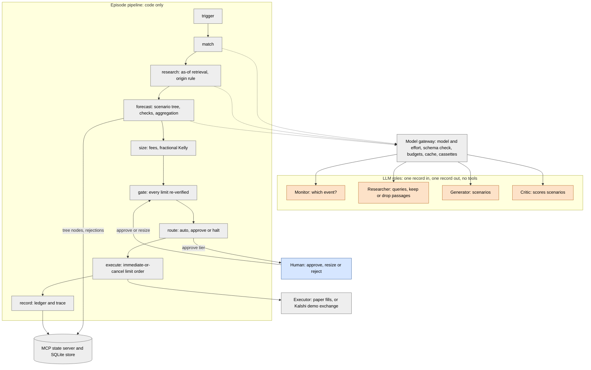

# pmfa: a prediction-market forecasting agent

[](https://github.com/youngminpark14/CMU-Capstone-Project/actions/workflows/ci.yml)

pmfa forecasts Kalshi prediction markets on U.S. economic releases (Federal Reserve rate decisions
and monthly CPI) and sizes positions on them. When a new official document appears or a price
moves, it matches the trigger to the event it affects, reads the event's rules, retrieves evidence
published before that moment, builds one probability for every market of the event from a search
over alternative scenarios, compares that forecast with the market price after fees, sizes an order
with fractional Kelly, checks it against hard limits in code, and either places an
immediate-or-cancel limit order or asks a human to approve it. Every step is recorded so any
decision can be replayed. Terms such as *episode*, *as-of time* and *origin* are defined in the
[glossary](docs/glossary.md).

What it does not do: it never trades real money and has no way to place an order on Kalshi's
production exchange; the only orders it can send go to Kalshi's demo exchange, which uses mock
funds. Nothing here is investment or trading advice.

### Status

| Area | State |
| --- | --- |
| Pipeline and tests | Built end to end. The offline suite runs with no keys and no network: 853 tests pass and 2 are skipped (an opt-in Kalshi smoke test, and a test that needs a locally cached embedding model), in under two minutes on one machine. |
| Episode scenarios | All sixteen scenarios from the specification pass in [tests/episodes/test_scenarios.py](tests/episodes/test_scenarios.py). |
| Offline replay | Five sample episodes replay with one command and match their committed outputs. |
| Real data | The exchange snapshot (7 settled events, 104 markets) and the evidence corpus (45 Federal Reserve and 10 BLS documents) were built from the live public sources on 2026-11-25. The counts are in the published [manifest](evaluation/runs/2026-11-25-market-baseline/manifest.json). |
| Measured | Only the market's own Brier score (see [Results](#results)). It is the baseline every later run is compared with. |
| Not yet done | **No live model call has been made in this repository**, because no Anthropic API key was available. The agent's forecasts have therefore not been measured. |
| Sample episodes | Hand-made fixtures: the inputs are real, but a person wrote every model record. They show the pipeline working, not forecasting skill, and each one says so. |
| Shadow mode | Exercised for plumbing only, against recorded worlds in [tests/live/](tests/live/). |
| Demo executor | Built from Kalshi's documentation and tested against recorded and constructed responses, not against a live demo account. |
| Fees | The fee formula and rounding are tested on hand-computed cases and one worked example from Kalshi's fee-rounding documentation. The fee schedule PDF's own worked examples are not in the tests: the PDF sits behind a browser check. |

Beating the market price is the hypothesis the evaluation tests, not a result of this project.

## Architecture

One pipeline, the *episode*, runs for each trigger. Four LLM roles read and judge; they return
records and cannot call tools. Code does everything else: every retrieval, check, number that
touches money, and order.



Every step can also end the episode early in a named *exit* (`no_match`, `no_evidence`,
`insufficient_origins`, `no_edge`, `gate_rejected` and others); most episodes end without a trade.
The full diagrams, the scenario tree search, a worked example and how to read a trace are in
[docs/architecture.md](docs/architecture.md).

## Review in ten minutes

Nothing to install.

1. **One sample episode.** Open [examples/inputs-and-outputs.md](examples/inputs-and-outputs.md),
   then [examples/episodes/fed-minutes-hawkish/](examples/episodes/fed-minutes-hawkish/): its
   README, `world.json` (inputs) and `expected/episode.json` (outputs). Look for: the trace as
   thought, action and observation steps, where thoughts are the only lines a model wrote; the
   passage ids each scenario cites, with source, URL and publish time; and the notice that the model
   records are hand-written.
2. **The guardrail table.** [docs/guardrails.md](docs/guardrails.md) lists every guardrail, whether
   code, the exchange or a human enforces it, and the test that shows it.
3. **The sixteen scenario tests.** [tests/episodes/test_scenarios.py](tests/episodes/test_scenarios.py):
   `test_01` to `test_16` run whole episodes against fixed worlds and assert what was decided (exit,
   forecast, proposal, routing tier, orders), for example that a halted agent sends no order in any
   mode and that a canary document dated after the as-of time is never retrieved.
4. **The evaluation report.** [evaluation/runs/2026-11-25-market-baseline/report.md](evaluation/runs/2026-11-25-market-baseline/report.md).
   Look for: the table of which systems ran and which did not, sample sizes by event as well as by
   market, and the section on how look-ahead was prevented.
5. **The decision records.** [docs/decisions/README.md](docs/decisions/README.md): 33 short
   records, each with the capstone checkpoint or build step it came from.

## Replay an episode offline

No account, no key, no network. With [uv](https://docs.astral.sh/uv/) and Python 3.12:

```bash
uv sync
```

```bash
uv run pmfa replay examples/episodes/fed-minutes-hawkish
```

It prints the hand-made-fixture notice first, then the trigger and as-of time, the numbered trace
(thought, action, observation), the forecast for each market next to the market price no role saw,
the proposal, all nineteen gate checks, the routing tier, the review card, the simulated order and
its fill, and the exit. `--check` compares the replay with the committed `expected/` files and exits
non-zero on any difference; `--verbose` prints each step's records; `--json` prints the episode
record.

The other four examples:

- [examples/episodes/phantom-edge-no-trade/](examples/episodes/phantom-edge-no-trade/): a hot CPI report the market had already priced; exit `no_edge`.
- [examples/episodes/review-resize/](examples/episodes/review-resize/): a reviewer shrinks an approve-tier proposal; the gate runs again and the smaller order fills.
- [examples/episodes/cpi-ladder/](examples/episodes/cpi-ladder/): one forecast gives monotone probabilities across real CPI strikes; no strike meets the liquidity floor, so `no_edge`.
- [examples/episodes/single-origin-syndicated/](examples/episodes/single-origin-syndicated/): one invented story syndicated twice counts as one secondary origin; exit `insufficient_origins`.

`uv run pmfa replay --list` lists them. [examples/README.md](examples/README.md) describes the files
and where each input came from.

## Setup

Python 3.12 and uv. `uv sync` installs the default environment (see
[Dependencies](#dependencies-and-the-two-environments)). Secrets are read only from the environment:
nothing reads a `.env` file for you, nothing logs or stores a key, and git ignores `.env` and key
files. [.env.example](.env.example) lists every variable.

### No keys: replay and the test suite

```bash
uv run pmfa replay fed-minutes-hawkish
```

```bash
uv run pytest
```

The suite is offline and deterministic. CI runs lint and the suite in both environments on every
push ([ci.yml](.github/workflows/ci.yml)).

### An Anthropic API key: rebuild the data, backtest, shadow mode

```bash
export ANTHROPIC_API_KEY=...
```

Rebuild the frozen data first. This step reads public Kalshi market data and Federal Reserve and BLS
pages and needs no key; the 2026-11-25 build took about 18 minutes for the snapshot.

```bash
uv run pmfa data build
```

BLS pages may refuse automated clients. When a release is not fetched, save it from a browser into
`data/manual/` as `bls-cpi-YYYY-MM.html` (the reference month, for example `bls-cpi-2026-10.html` for
the October CPI) and run `pmfa data build` again. The steps are in the docstring of
[bls.py](src/pmfa/world/evidence/bls.py).

Then plan the backtest. The dry run prints the model calls and the dollar estimate per system and
calls no model; the order in which to run the real backtest (a subsample first, then the full run)
and what each step costs are in
[docs/evaluation.md](docs/evaluation.md#running-the-systems-that-need-a-model). Without the key,
`pmfa backtest` still runs and scores the market alone.

```bash
uv run pmfa backtest --dry-run
```

Shadow mode runs one pass on live Kalshi prices and live Federal Reserve and BLS listings, and
records the trades it would make on paper:

```bash
uv run pmfa shadow
```

### A Kalshi demo key: approved orders on the demo exchange

Create an API key on Kalshi's demo exchange (mock funds), restricted to one numbered subaccount
(default 1, `kalshi.demo_subaccount`). Then:

```bash
export KALSHI_DEMO_KEY_ID=...
export KALSHI_DEMO_PRIVATE_KEY_PATH=/path/to/demo-key.pem
```

`KALSHI_DEMO_PRIVATE_KEY` can hold the PEM text instead of a path. Demo mode also needs
`ANTHROPIC_API_KEY`.

```bash
uv run pmfa demo
```

Every demo order waits for you: `pmfa review list --mode demo`, then approve, resize or reject.

Export only the variables you use. An exported but empty `PMFA_CONFIG` makes configuration loading
fail, so do not load `.env.example` unchanged into your shell.

## Run modes

The pipeline code is identical in every mode; only what sits behind its ports changes.

| Mode | Exchange | Evidence | Models | Orders | Command |
| --- | --- | --- | --- | --- | --- |
| Replay | One recorded file | Recorded documents and retrieval calls | Cassettes (recorded model records) | Simulated | `pmfa replay NAME` |
| Backtest | Frozen snapshot, read as of each forecast time | Frozen corpus, read as of each forecast time | Claude API, cached | Simulated from candles | `pmfa backtest` |
| Shadow | Kalshi production, public data only, no credentials | Live Federal Reserve and BLS listings | Claude API | Simulated against the live order book | `pmfa shadow` |
| Demo | Kalshi demo exchange | Live Federal Reserve and BLS listings | Claude API | Real orders on the demo exchange, mock funds, human approval | `pmfa demo` |

`pmfa shadow` and `pmfa demo` run one pass by default; `--loop` repeats every `--interval` seconds
(default 300) until Ctrl-C. In shadow mode approve-tier proposals are filled on paper and tagged;
`pmfa shadow --review` pauses them for you instead. Demo P&L is never reported as evidence: Kalshi
warns that demo prices may not reflect real markets.

## Commands

`uv run pmfa --help` and `uv run pmfa COMMAND --help` show every option.

| Command | What it does |
| --- | --- |
| `pmfa replay` | Replay a recorded episode offline and print its trace (`--list`, `--check`, `--verbose`, `--json`). |
| `pmfa trace` | Print a stored episode's trace from a state database. |
| `pmfa data build` | Rebuild the evidence corpus and the exchange snapshot for the backtest window. |
| `pmfa data status` | Print the corpus and snapshot manifests. |
| `pmfa backtest` | Score the systems on the frozen snapshot and simulate news-triggered trading (`--dry-run`, `--limit`, `--systems`, `--cap`). |
| `pmfa report` | Build `report.md` and figures for a run directory; `--publish NAME` copies it to `evaluation/runs/NAME`. |
| `pmfa shadow` | Shadow mode: live data, simulated fills, no orders. |
| `pmfa demo` | Demo mode: Kalshi's demo exchange, mock funds, every order needs approval. |
| `pmfa review` | `list`, `show`, `approve`, `resize` and `reject` proposals that wait for you. |
| `pmfa halt` | Set the persisted halt flag and cancel all open orders; `--status`, `--resume`. |
| `pmfa stage` | `status`, `advance` and `demote` the autonomy stage; `advance` refuses unless the benchmark is met. |
| `pmfa state-server` | Serve a state database over MCP on stdio, for browsing episodes with any MCP client. |
| `pmfa resolve` | Run the outcome resolver once and print what resolved. |
| `pmfa config` | `show` the effective configuration, or `check` a file. |
| `pmfa report-status` | Print the monitoring report: P&L, drawdown, exits, rejections, fills, overrides, calibration. |

## Configuration

[pmfa.toml](pmfa.toml) holds every limit, threshold, source, model assignment and followed series,
with comments. It is the built-in defaults as `pmfa config show` writes them, and a test keeps the
two equal, so leave it unchanged. To change a value, write a TOML file with only the keys you change
(defaults fill in the rest), check it, and point `PMFA_CONFIG` at it. That file then replaces
`pmfa.toml`; it is not layered on top of it.

```bash
uv run pmfa config check my-config.toml
```

```bash
export PMFA_CONFIG=my-config.toml
```

`pmfa backtest` also takes `--config FILE` and `--cap DOLLARS`. The configuration refuses to load
when caps contradict each other, for example a per-order cap at or above the exchange order group's
50-contract limit.

The most important defaults:

| Setting | Default |
| --- | --- |
| Followed series | `KXFEDDECISION` (Fed decision), `KXCPIYOY` (CPI year over year) |
| Kelly fraction | 0.25 (quarter-Kelly), multiplied by forecast confidence |
| Shrinkage toward the market price | 0.5 |
| Minimum edge after fees | $0.02 per contract |
| Caps | 25 contracts per order; 5% of bankroll per market; 10% per event |
| Stops | Daily loss stop 3% of bankroll; drawdown halt 10% below peak equity |
| Liquidity floor | $500 resting within $0.02 of the touch |
| Notional bankroll (backtest, shadow) | $1,000 |
| Proposal expiry | 10 minutes |
| Budget per episode | 30 model calls, $2.00, 90 seconds (live modes) |
| Budget per run | $25.00 |
| Backtest window start | 2026-07-01 |

## Guardrails

Models read and judge; code acts. The main guardrails:

| Guardrail | Enforced by |
| --- | --- |
| Roles have no tools: one validated record in, one out | Code |
| Evidence text reaches a model only inside delimited blocks, as data | Code |
| No role sees the price of the market it forecasts | Code |
| Nothing published or priced after the as-of time is read | Code |
| A trade needs one primary origin or two independent secondary origins | Code |
| The gate re-verifies every cap, the edge and the limit price, and never changes an order | Code |
| Limit orders only, immediate-or-cancel only | Code |
| The halt flag blocks every order in every mode; the agent halts itself on loss, drawdown and fill-failure stops | Code |
| The production exchange adapter has no order methods and loads no credentials | Code |
| A trade goes to a human unless every auto condition holds at the autonomous stage | Code, then human |
| Approve, resize smaller, or reject with a reason code | Human, checked by code |
| The demo key is restricted to one subaccount and cannot transfer funds | Exchange |
| More than 50 contracts in 15 seconds cancels the order group's orders | Exchange |
| Calls, dollars and seconds are capped per episode, dollars per run | Code |

The full table, with the file that enforces each guardrail and the test that shows it, and what is
not guaranteed, is in [docs/guardrails.md](docs/guardrails.md).

## Results

One backtest has been run and published:
[evaluation/runs/2026-11-25-market-baseline/](evaluation/runs/2026-11-25-market-baseline/report.md).
It scored only the market's own price (the YES mid, or the last trade when one side of the quote was
empty) at 7, 3 and 1 days before each event's close, because the systems that need a model could not run without an API key. These numbers are not the
agent's. They are the bar any later system has to clear: Brier skill is
1 − system Brier ÷ market Brier on the same rows.

<!-- results-table:start (tests/docs/test_readme.py checks these numbers against metrics.json) -->
| Horizon | Forecasts | Markets | Events | Market Brier score | 95% interval |
| --- | --- | --- | --- | --- | --- |
| all | 312 | 104 | 7 | 0.0345 | 0.0108 to 0.0773 |
| 7d | 104 | 104 | 7 | 0.0377 | 0.0117 to 0.0800 |
| 3d | 104 | 104 | 7 | 0.0330 | 0.0092 to 0.0759 |
| 1d | 104 | 104 | 7 | 0.0328 | 0.0095 to 0.0755 |
<!-- results-table:end -->

The Brier score is the mean squared error of a probability against the 0-or-1 outcome; lower is
better. Intervals come from 2,000 bootstrap resamples of whole events. Seven events are the
independent observations, not 104 markets, so the intervals are wide. Markets priced near 0.01 or
0.99 dominate the rows and pull every score toward zero. The market's expected calibration error
over all horizons is 0.0566. Prompt-only, single-pass and the full pipeline were not run, and there
is no simulated P&L.

Look-ahead is prevented inside the ports, not by the caller: every exchange read and retrieval
filters on the as-of time inside the call; a canary document dated after the window sits in the
retrieval index and aborts the run if any query returns it; the backtest world has no web access;
and a run refuses to start if any assigned model's knowledge cutoff falls on or after the window
start. Method and controls: [docs/evaluation.md](docs/evaluation.md). The notebook
[notebooks/evaluation.ipynb](notebooks/evaluation.ipynb) reproduces the report's figures and tables
from the committed files.

## Limitations

- **The agent's forecasting has not been measured.** No live model call has been made here; the only
  measured number is the market's own Brier score.
- **The sample is small.** The window from 2026-07-01 holds 7 settled events in the two followed
  series. No result on it can separate skill from luck; the harness is the deliverable and its numbers
  are a pilot.
- **Market prices in the backtest can be stale.** They come from one-minute candles, which exist only
  when a quote or trade changed; the median price was 35.5 hours old.
- **Backtest fills are simulated from candles.** Kalshi's history has no order-book depth, so
  liquidity is a candle-volume proxy and some fills fall back to hourly candles.
- **Sample episodes are hand-made.** Their model records were written by a person who knew the
  outcomes.
- **Exchange-side protections are documented, not verified.** The subaccount restriction, the
  funds-transfer block and the order-group breaker have not been exercised against a live demo
  account.
- **An injected passage can still distort a probability**, within the caps; roles cannot act on it.
- **Evidence is official sources only**: Federal Reserve and BLS. No news wires or web search.
- **Two days of daily loss stops do not demote the stage automatically yet**; the stage manager
  applies the rule only when asked.

## Dependencies and the two environments

The lockfile ([uv.lock](uv.lock)) carries two dependency sets because CrewAI, which defines the four
LLM roles, requires the MCP SDK below version 2, while the state server also supports the MCP SDK 2
line. The two cannot share one environment
([decision 0013](docs/decisions/0013-two-dependency-sets.md)).

| Environment | Install | Roles run through |
| --- | --- | --- |
| Default: `dev` and `crewai` groups, MCP SDK 1.x | `uv sync` | CrewAI single-agent kickoffs bound to the model gateway |
| Alternative: `dev` and `mcp2` groups, MCP SDK 2.x | `uv sync --no-group crewai --group mcp2` | The model gateway directly, with the same prompts and records |

CI runs the full offline suite in each. The optional `notebook` group
(`uv sync --group notebook`) adds a Jupyter kernel for [notebooks/](notebooks/README.md).

## Sources and credits

Evidence text comes from the Board of Governors of the Federal Reserve System
([federalreserve.gov](https://www.federalreserve.gov/disclaimer.htm)) and the U.S. Bureau of Labor
Statistics ([bls.gov](https://www.bls.gov/bls/linksite.htm)). Both agencies place their text in the
public domain and ask to be credited as the source; this project credits them here, and each
example's README names its sources and URLs. Market data comes from Kalshi's public API. The
exchange data committed in this repository is kept small (one event and a handful of markets per example, no candle series) until
Kalshi's data terms are checked; the full snapshot and corpus are rebuilt locally and ignored by git.
The one synthetic story in `single-origin-syndicated` uses made-up outlets on reserved `.example`
domains.

## Educational use

This is a course project that runs on mock funds. It is not trading or investment advice, not a
production trading system, and not affiliated with Kalshi, the Federal Reserve or the Bureau of Labor
Statistics. Real-money trading is out of scope by design
([decision 0010](docs/decisions/0010-no-real-money.md)).

## License

MIT. See [LICENSE](LICENSE).

## Acknowledgment

Built as a capstone project for a Carnegie Mellon University program. The design comes
from the program's capstone checkpoints and the instructor's feedback on them; the specification is
[docs/spec.md](docs/spec.md).
