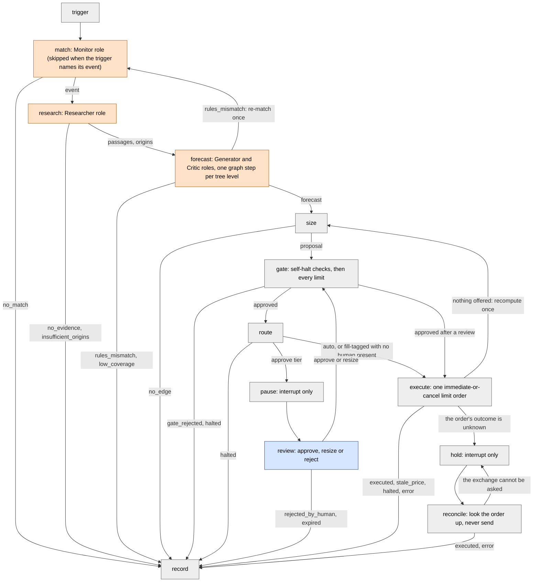
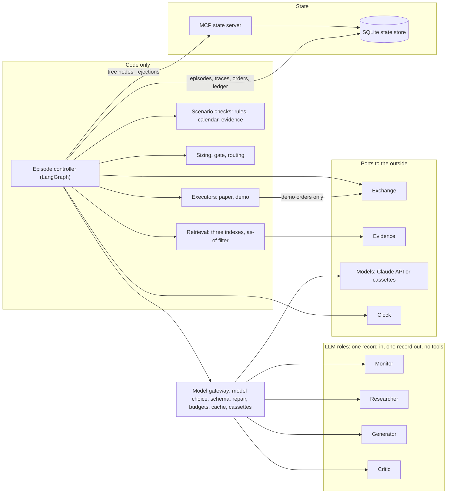

# Architecture

pmfa runs one pipeline, the *episode*, for each trigger: it matches the trigger to an event, gathers
dated evidence, forecasts every market of the event, sizes one order, checks the order against hard
limits, decides who approves it, and records everything. Four LLM roles do the reading and the
judging. Code does everything else: every retrieval, every check, every number that touches money,
and every order. This page shows where that line runs.

Terms in *italics* on first use are defined in the [glossary](glossary.md). Decisions behind the
design are in [decisions/](decisions/README.md); the safety properties are in
[guardrails.md](guardrails.md); the specification is [spec.md](spec.md).

## The episode pipeline

Each box is one node of the LangGraph graph in [graph.py](../src/pmfa/episode/graph.py); the
node bodies are in [pipeline.py](../src/pmfa/episode/pipeline.py). Orange boxes call an LLM role
through the model gateway. Grey boxes are code only. The blue box is the human. Every path ends in
`record`, and every episode ends in exactly one named *exit*, shown on the arrows into `record`.
Most episodes end without a trade.



A thirteenth exit, `error`, can leave from any node: a model answer that fails validation twice, a
budget cap reached outside the tree search, the run's dollar cap (see
[budgets](guardrails.md#budgets-per-episode-and-per-run)), or any other project error a node raises,
such as an unknown fee type or an exchange failure. At `execute` it also covers an order the
exchange rejected, a send whose outcome could not be established, and a continued episode that
finds no order (see [sending an order](guardrails.md#sending-an-order)). Every episode ends in
exactly one exit. A few errors are not turned into exits and stop the run instead: a read past the
as-of time (the backtest's canary among them), a replay that no longer matches its recording, an
error inside `record` itself, and an unexpected exception that is not one of the project's own
errors.

The graph has three forecast nodes (`forecast_start`, `forecast_step` once per tree level,
`forecast_finish`) so the checkpointer saves the search between levels; the diagram draws them as one
box. `pmfa.episode.mermaid()` prints the exact wiring.

What each step does, in the code's terms:

| Step | Who | What happens | Exits |
| --- | --- | --- | --- |
| trigger | code | Saves a new episode record. The trigger's time becomes the *as-of time* (in a backtest's trading pass, an episode that starts late runs on the trigger re-dated to its start). | |
| match | Monitor, or code | A *new-document* trigger: code searches the events index for the top 5 open events, and the Monitor picks one or none. The index holds one row per listing change of an event, so a ladder strike that opens later is not shown before it opens. A *price-move* or *schedule* trigger already names its event, so no model is called. | `no_match` |
| research | Researcher, then code | The Researcher writes one query for and one against. Code retrieves the top 8 passages as of the as-of time; for a price-move trigger, only passages published after the event's last forecast count, so a price move with no new evidence since then ends in `no_evidence`. The Researcher drops passages that do not bear on the event. Code resolves *origins*, merging documents whose text is a copy of another's, and applies the origin rule. | `no_evidence`, `insufficient_origins` |
| forecast | Generator, Critic, code | Reads every open market's book and keeps each market's YES mid as the forecast-time price: the midpoint of the YES bid and ask when both sides are quoted, else the last trade. Beam search over a scenario tree ([below](#the-scenario-tree-search)). | `rules_mismatch`, `low_coverage` |
| size | code | Picks the one market and side with the best fee-adjusted *edge* that meets the liquidity floor, sizes it at quarter-Kelly times confidence, and proposes the difference from the current holding. | `no_edge` |
| gate | code | Runs the self-halt conditions, then re-verifies every limit with its own arithmetic. | `gate_rejected`, `halted` |
| route | code | Scores the risk and assigns the *routing tier*: auto, approve or halt. The price move it scores is measured from the forecast-time price, so a recompute cannot re-base it. | `halted` |
| pause, review | human | The graph stops and waits ([below](#the-human-approval-pause)). | `rejected_by_human`, `expired` |
| execute | code | Reads the halt flag, then re-reads the *execution book*. If nothing is offered at or below the limit price, no order is sent: the episode re-sizes once on fresh books; after that, or after a review, it exits `stale_price`. Otherwise it reads the halt flag again and places one immediate-or-cancel limit order. An order the exchange rejects ends in `error`; one it accepts ends in `executed`, filled or not. When the exchange fails while the order is sent and the lookup by client order id finds nothing or fails itself, the outcome is unknown: the episode and the proposal are saved `outcome_unknown`, with no exit and no rejection recorded, and nothing more is sent. | `executed`, `stale_price`, `halted`, `error` |
| hold, reconcile | code | Only for an order whose outcome is unknown. `hold` waits. `reconcile` looks the order up by its client order id and never sends: an order it finds is recorded and the episode ends by what the exchange did; when the exchange lists none, the proposal is cancelled and the episode ends `error`; when the exchange cannot be asked, the episode waits again. | `executed`, `error` |
| record | code | Writes the forecast and one *ledger* entry per market, with the forecast-time price, and closes the episode record. | |

## The parts: roles, code, gateway, state, ports



- **LLM roles** are prompt and schema definitions in [models/roles/](../src/pmfa/models/roles/).
  A role never calls a tool. It reads one input record from
  [records/roles.py](../src/pmfa/records/roles.py) and returns one output record, which the gateway
  validates. The Critic has three model slots (depth 1, depths 2 and 3, and the fast path).
- **The model gateway** ([gateway.py](../src/pmfa/models/gateway.py)) is the one place a role call
  becomes an API request. It owns the model and effort per slot, native JSON-schema output with one
  repair retry, the call, dollar and seconds caps, the response cache, and cassette recording.
- **Code-only parts** are ordinary functions. The decision core
  ([decision/](../src/pmfa/decision/)) does no I/O and calls no model.
- **The state store** is one SQLite database. The controller writes the roles' shared state (tree
  nodes, critic rejections) through the MCP state server, in process, except in backtests, which
  call the same state service directly for throughput
  ([decision 0031](decisions/0031-state-transport.md)); everything else goes to the store directly.
  A reviewer can attach any MCP client to the same server to browse episodes and traces:
  `python -m pmfa.state --db PATH` (or `pmfa state-server`) serves a database over stdio.
- **Ports** ([ports.py](../src/pmfa/ports.py)) are the only way out: `Exchange` (market data),
  `Executor` (orders and holdings), `Evidence` (documents and the release calendar), `Knowledge`
  (the retrieval indexes), `Models` (the gateway or a stand-in), `Clock`, and `StateStore`. A
  *world* is one implementation of each; a *run mode* is a choice of world.

## The four run modes and what sits behind each port

The pipeline code is identical in every mode. Only what sits behind the ports changes.

| Port | Replay | Backtest | Shadow | Demo |
| --- | --- | --- | --- | --- |
| Exchange | One recorded JSON file ([recorded.py](../src/pmfa/world/recorded.py)) | Frozen snapshot read as of the clock ([snapshot/reader.py](../src/pmfa/world/snapshot/reader.py)) | Kalshi production, public data only, no credentials ([kalshi/production.py](../src/pmfa/world/kalshi/production.py)) | Kalshi demo exchange ([kalshi/demo.py](../src/pmfa/world/kalshi/demo.py)) |
| Evidence | Documents in the recorded file | Frozen corpus read as of the clock ([evidence/corpus.py](../src/pmfa/world/evidence/corpus.py)) | Live Federal Reserve and BLS sources, plus any RSS or Atom feeds listed in `sources.feeds` (none by default) ([evidence/live.py](../src/pmfa/world/evidence/live.py)) | The same as shadow |
| Models | Cassettes ([cassette.py](../src/pmfa/models/cassette.py)) | Claude API through the gateway, with the response cache | Claude API | Claude API |
| Executor | Paper. Decisions read the recorded execution-time books; orders fill against the recorded fill books where the recording has them | Paper. Decisions read the as-of book; orders fill against a book built from the one-minute candle, else the hourly candle, that holds the order's arrival time (the as-of time plus the latency), which no decision sees, and the fill counts only from that candle's end | Paper, against the live order book | Demo exchange: real orders, mock funds |
| Who approves | The recorded review, if any | Nobody: approve-tier trades are filled and tagged | Nobody by default (filled and tagged), or a human when review is turned on | A human, for every order: demo mode always runs at the approval stage |
| Clock | Simulated | Simulated | System | System |

**Demo P&L is never evidence.** Kalshi warns that demo prices may not reflect real markets, and its
funds are mock. Demo mode exists to show the execution plumbing and the human oversight working on a
real exchange API. Evidence about forecasting skill comes from backtests (scored against the market
price at the same moment) and from shadow mode (simulated fills against live prices).

`pmfa shadow` and `pmfa demo` run one pass by default; `--loop` repeats every `--interval` seconds
(default 300) until Ctrl-C. In shadow mode approve-tier proposals are filled on paper and tagged;
`pmfa shadow --review` pauses them for you instead.

Demo mode always runs at the approval stage, whatever stage is stored, so every demo order waits for
you: `pmfa review list --mode demo`, then approve, resize or reject. Approval runs the gate again at
the current price before the order is sent.

The worlds are assembled in [recorded.py](../src/pmfa/world/recorded.py),
[backtest.py](../src/pmfa/world/backtest.py) and [live.py](../src/pmfa/world/live.py). In shadow and
demo mode a foreground loop ([live/loop.py](../src/pmfa/live/loop.py)) repeats one pass: refresh the
indexes, resolve settled outcomes, ask again about orders whose outcome is unknown, expire due
proposals, apply the self-halt conditions and the stage demotion rule, detect triggers and run
their episodes (a trigger whose episode exists and is not finished is left alone), and record a
*marked equity* point.
The command for each mode is `pmfa replay NAME`, `pmfa backtest`, `pmfa shadow` or `pmfa demo`
(see [Commands](#commands)).

## The modules

| Module | What it is |
| --- | --- |
| [records/](../src/pmfa/records/) | Immutable Pydantic records that cross module boundaries: the shared vocabulary. Prices and money are decimals; times are timezone-aware UTC. |
| [ports.py](../src/pmfa/ports.py) | The protocols every world implements, and the `World` that bundles them. |
| [config.py](../src/pmfa/config.py) | One typed configuration with every limit, threshold, source, model slot and followed series. It is validated at load, including that the caps agree with each other. |
| [episode/](../src/pmfa/episode/) | The LangGraph controller: `run(trigger)`, `resume(episode_id, review)`, `expire(episode_id)`, and the trace writer. |
| [world/](../src/pmfa/world/) | Adapters behind the ports: the Kalshi client (signing, fixed-point parsing, pagination, throttling), the snapshot builder and reader, the evidence sources, clocks, and the recorded, backtest and live worlds. |
| [knowledge/](../src/pmfa/knowledge/) | Chunking, embedders, the Chroma indexes with the as-of filter inside every query, origin resolution, and ranking. |
| [state/](../src/pmfa/state/) | The SQLite store, the state service, and its MCP server for either MCP SDK line. |
| [models/](../src/pmfa/models/) | The gateway, the Anthropic backend, the cache, cassettes, scripted models for tests, meters, and the four roles. |
| [forecast/](../src/pmfa/forecast/) | Outcome spaces, tree levels, the code checks, beam search with the protected slot, aggregation, quantile conversion, and the pruning audit. |
| [decision/](../src/pmfa/decision/) | Fees, ticks, sizing, the gate, risk state and routing. Pure functions. |
| [execution/](../src/pmfa/execution/) | The paper executor, the paper portfolio, the review queue, halt, and the stage manager. The demo executor lives with the Kalshi adapters in [world/kalshi/demo.py](../src/pmfa/world/kalshi/demo.py). |
| [evaluation/](../src/pmfa/evaluation/) | The backtest runner, the one-call baselines, the outcome resolver, metrics (Brier score, skill, reliability), the clustered bootstrap, P&L, and the stage benchmarks. |
| [live/](../src/pmfa/live/) | Trigger detection and the foreground loop for shadow and demo mode. |
| [cli/](../src/pmfa/cli/) | The `pmfa` command. |

## Worked example: recency against similarity

The instructors' feedback on checkpoint 3.1 asked for an example of recency decay putting a newer
Federal Reserve release ahead of an older, semantically similar text. Here is one from the frozen
backtest corpus. [ranking.py](../src/pmfa/knowledge/ranking.py) scores a passage as similarity times
0.5 ^ (age in days / half-life), with a 30-day half-life, and keeps at most three passages per
origin; the `similarity` variant drops both. The query is "Will the Federal Reserve raise the
federal funds target range at its next meeting?", as of 2026-10-26 00:00 UTC, two days before the
October decision, with the default hashing embedder.

| Ranking | Rank | Passage | Published | Age (days) | Similarity | Recency factor | Score |
| --- | --- | --- | --- | --- | --- | --- | --- |
| Similarity alone | 1 | FOMC statement, July meeting | 2026-07-29 | 88.2 | 0.339 | not applied | 0.339 |
| Similarity alone | 2 | Minutes, June meeting, passage 21 | 2026-07-08 | 109.2 | 0.325 | not applied | 0.325 |
| Similarity alone | 3 | Minutes, July meeting, passage 23 | 2026-08-19 | 67.2 | 0.318 | not applied | 0.318 |
| Similarity alone | 4 | Minutes, September meeting, passage 20 | 2026-10-07 | 18.2 | 0.276 | not applied | 0.276 |
| Similarity alone | 5 | FOMC statement, September meeting | 2026-09-16 | 39.2 | 0.275 | not applied | 0.275 |
| With recency | 1 | Minutes, September meeting, passage 20 | 2026-10-07 | 18.2 | 0.276 | 0.656 | 0.181 |
| With recency | 2 | Minutes, September meeting, passage 17 | 2026-10-07 | 18.2 | 0.272 | 0.656 | 0.178 |
| With recency | 3 | Minutes, September meeting, passage 16 | 2026-10-07 | 18.2 | 0.239 | 0.656 | 0.157 |
| With recency | 4 | Governor's speech on economic data, opening | 2026-10-01 | 24.4 | 0.217 | 0.569 | 0.124 |
| With recency | 5 | Governor's speech on rural America, opening | 2026-09-30 | 25.2 | 0.209 | 0.559 | 0.117 |

By similarity alone the July statement comes first. Its recency factor of 0.130 cuts its score to
0.044, and the September minutes, the newest FOMC document at the as-of time, take the first three
places. For a forecast of the October decision that is the right order: those minutes record the
September increase to 3-3/4 to 4 percent, and most participants judging another likely by year
end; the July statement records a hold at a range that no longer applies. The factor has a cost:
the opening passages of two recent speeches, not about the policy rate, now rank above the
September statement.

[scripts/recency_example.py](../scripts/recency_example.py) prints both rankings after
`pmfa data build`; [test_recency_example.py](../tests/knowledge/test_recency_example.py) recomputes
it from a fixture of the nine passages. One query on one date with one embedder illustrates the
mechanism and does not measure its value. The measurement is the ranking ablation in
[evaluation.md](evaluation.md#systems-compared) (`single_pass` against `single_pass_similarity`),
which has not been run with a model.

## The scenario tree search

The forecast engine ([forecast/engine.py](../src/pmfa/forecast/engine.py)) turns one event and its
evidence into one *forecast*: a probability for every market of the event.

**Outcome space.** Code builds the event's mutually exclusive outcomes from its markets
([outcomes.py](../src/pmfa/forecast/outcomes.py)). A Fed decision has five options (hike more than
25 bp, hike 25, hold, cut 25, cut more than 25). A CPI event is a *ladder*: its strike markets cut
the reported number into bins. Every market maps to the outcomes on which it resolves YES, so one
distribution over outcomes gives consistent probabilities for every market.

**Levels.** Each tree depth is one scheduled event ([levels.py](../src/pmfa/forecast/levels.py)):
up to two of the nearest calendar entries between the as-of time and the event's close, then the
event's own resolution, which is always last. Depth is at most 3. An event that closes within 60
minutes takes the *fast path*: the resolution level alone, on the fast-path model slot.

**One level, for each parent** (the root at depth 1, otherwise each expanded scenario above):

1. The Generator proposes up to 3 *scenarios*: claims about the level's event, each citing passage ids.
2. Code checks each one ([checks.py](../src/pmfa/forecast/checks.py)) and deletes it on any failure:
   - *rules*: at the resolution level it asserts outcomes that exist (valid option ids, or a finite
     numeric range); before it, it asserts no resolution outcome;
   - *calendar*: the level's event falls after the as-of time and no later than the close;
   - *evidence*: it cites at least one passage, and every cited passage was supplied, predates the
     as-of time, and belongs to a counted origin.
3. The Critic scores the surviving siblings in one call. It sees the claims and their cited passages,
   never the Generator's rationale. For each scenario it gives a probability given the parent, and
   an outcome distribution if that path holds (option probabilities, or five quantiles for a ladder).
   Code clips sibling probabilities to [0, 1] and scales them down if they sum above 1; the remainder
   is unexplored mass. The Critic may reject a scenario with a reason (stored, and shown to the
   Generator so it is not proposed again) and may ask for more evidence once per scenario, at most 3
   times per episode. Code runs that query, the Researcher filters the results, and the siblings are
   re-scored once.

If every first-level scenario fails the rules check, the episode re-matches once without that event
(new-document triggers only), then exits `rules_mismatch`.

**Choosing the beam.** Each scored scenario has a *path mass* (the product of conditional
probabilities down its path) and an *evidence support* in [0, 1] from the independent origins it
cites and their age ([support.py](../src/pmfa/forecast/support.py)):
`support = min(1, sum of weight x 0.5^(age in days / 30) / 2)`, with weight 2 for a primary origin
and 1 for a secondary one. Scenarios are ranked by path mass times support. When several are within
0.05 of the best remaining score, the one citing more independent origins goes first, then the one
with fresher evidence. The top 3 form the *beam* and are expanded at the next level.

**The protected slot.** For each scenario outside the beam, code re-aggregates the forecast without
it and re-runs sizing. It is a candidate if its removal would flip the trade's direction, change the
trade's cost by more than one *risk unit* (1% of bankroll), or push a tradable market's probability
to exactly 0 or 1. The candidate that moves the size most is expanded as well. Every other scenario
outside the beam is *frozen*: it is not expanded, and it still counts in the forecast with its
probability and its last outcome distribution. At the resolution level every scored scenario is a
leaf.

**Aggregation** ([aggregate.py](../src/pmfa/forecast/aggregate.py)). The forecast is made of every
scored scenario with no scored children: leaves, frozen scenarios, and expanded scenarios whose
children were all deleted or rejected. For each outcome,
`P(outcome) = sum(path mass x scenario's P(outcome)) / total mass`, and a market's probability is the
sum over its outcomes. *Coverage* is the total mass. Below 0.6 the episode exits `low_coverage`.

**Confidence** is `coverage x min(1, independent origins / 3)`, halved when an episode cap (calls,
dollars or seconds) ended the search. Only origins cited by the scenarios in the forecast count.
Confidence multiplies the Kelly size, so it can only make an order smaller.

**Ladders.** For a ladder, the Critic gives the 5th, 25th, 50th, 75th and 95th percentiles. Code
draws a continuous distribution through them, linear between quantiles, with exponential tails that
carry 5% each and start at the density of the adjacent segment
([quantiles.py](../src/pmfa/forecast/quantiles.py)). Because CPI is reported to 0.1, "above 3.6%"
means an unrounded value of at least 3.65, so every bin edge is shifted up by half the reporting
step. Every bin gets at least 1e-9, so no ladder market is ever exactly 0 or 1, and nested strikes
are always monotone.

### A worked example

A Fed decision event, two calendar entries before the meeting (a CPI release, then a jobs report),
so three levels. The numbers are hand-picked; the beam order and the aggregate were run through the
engine's own functions.

*Depth 1 (CPI release).* The Critic scores A, "CPI comes in hot", at 0.70 and B, "CPI comes in cool",
at 0.25. Unexplored mass is 0.05. Two scenarios fit in a beam of three: both are expanded.

*Depth 2 (jobs report).* Four children are scored:

| Scenario | P(given parent) | Path mass | Support | Origins | Mass x support |
| --- | --- | --- | --- | --- | --- |
| A1 strong jobs | 0.60 | 0.70 x 0.60 = 0.420 | 1.0 | 2 | 0.420 |
| A2 weak jobs | 0.30 | 0.210 | 0.8 | 1 | 0.168 |
| B1 strong jobs | 0.50 | 0.125 | 1.0 | 2 | 0.125 |
| B2 weak jobs | 0.40 | 0.100 | 0.5 | 1 | 0.050 |

A1 is first. Among the rest, A2 (0.168) and B1 (0.125) are within 0.05 of each other, and B1 cites
more independent origins, so B1 goes second and A2 third. The beam is A1, B1, A2. B2 is outside it.
Removing B2 changes neither the trade's direction nor its cost by more than $10 on a $1,000 bankroll,
and moves no market to 0 or 1, so B2 is frozen: it gets no children but keeps its mass, 0.100, and
its distribution (hold 0.30, cut 0.70).

*Depth 3 (resolution).* Each expanded parent gets one leaf: A1a with P = 0.9 (mass 0.378; hold 0.95,
cut 0.05), A2a with P = 0.8 (mass 0.168; hold 0.80, cut 0.20), B1a with P = 1.0 (mass 0.125; hold
0.60, cut 0.40).

*Aggregate.* The forecast is made of A1a, A2a, B1a and the frozen B2.

- Coverage = 0.378 + 0.168 + 0.125 + 0.100 = 0.771, above the 0.6 floor.
- P(hold) = (0.378 x 0.95 + 0.168 x 0.80 + 0.125 x 0.60 + 0.100 x 0.30) / 0.771 = 0.5985 / 0.771 = 0.776.
- P(cut 25) = 0.1725 / 0.771 = 0.224.
- With two independent origins cited, confidence = 0.771 x 2/3 = 0.514.

Dropping the frozen B2 instead of keeping it would give P(cut 25) = 0.1025 / 0.671 = 0.153: the
forecast would drift toward the likeliest path. That is why frozen scenarios stay in.

The search made 6 Generator and 6 Critic calls (1, 2 and 3 parents). A full depth-3 tree has at
most 9 parents: 1, then the beam plus the protected slot at each of the next two levels. Each
parent takes one Generator and one Critic call, so 9 of each. Evidence follow-ups come on top: at
most 3 per episode, each with at most one Researcher call to filter its results, and a parent whose
follow-ups added passages has its children scored once more, so the Critic gives at most 12
answers. Each count is of answers: an answer that fails validation gets one repair retry, which is
one more call. `full_tree_calls` in [config.py](../src/pmfa/config.py) counts the 18 answers without
the follow-ups or the retries.

## From forecast to order: one example

This is the episode test for hawkish Fed minutes (scenario 4 in
[test_scenarios.py](../tests/episodes/test_scenarios.py)), with scripted roles. The forecast gives the
"cut 25 bp" market 0.18 for YES; its YES mid is 0.33; the NO side's best ask is 0.68.

1. **Shrink** toward the market by the category factor 0.5: 0.5 x 0.33 + 0.5 x 0.18 = 0.255 for YES,
   so 0.745 for NO.
2. **Edge** at the ask, with the unrounded taker fee 0.07 x 0.68 x 0.32 = 0.0152 per contract:
   0.745 - 0.68 - 0.0152 = 0.0498, above the 2¢ minimum. NO on this market is the best edge in the event.
3. **Size.** Full Kelly on the fee-inclusive cost c = 0.6952 is (0.745 - c) / (1 - c) = 0.163 of
   bankroll. Quarter-Kelly times confidence 1/3 on $1,000 is $13.61, or 19 whole contracts.
4. **Limit and bound.** The highest price that still keeps a 2¢ edge is 0.71. The order needs only
   the 0.68 level, so the limit is 0.68.
5. **Rounded fee.** 19 contracts cost a fee of $0.2894, rounded up to $0.29. The edge after rounding
   is 0.745 - 0.68 - 0.29/19 = 0.0497, still above 2¢. Cost is 19 x 0.68 + 0.29 = $13.21.
6. **Gate** re-derives all of this and approves. **Route** sends it to the approve tier: the cost is
   above one risk unit ($10), and the category has no calibration record yet.

## The human-approval pause

An approve-tier proposal is decided by a person, possibly in another process and minutes later.

1. `route` saves the proposal as `pending` with its review card, saves the episode as
   `pending_review`, and goes to `pause`.
2. `pause` does one thing: it calls LangGraph's `interrupt()`. The graph's state, plain JSON only, is
   in the checkpointer. In the live modes that is a SQLite file
   (`open_checkpointer(path)` in [controller.py](../src/pmfa/episode/controller.py)). The first
   process can exit.
3. A second process builds an `EpisodeController` over the same state database and checkpoint file
   and calls `resume(episode_id, review)`. The review queue
   ([review.py](../src/pmfa/execution/review.py)) checks the proposal and the decision first. A
   proposal more than 10 minutes old, or whose side's best ask is now above its edge bound, has
   expired: the episode ends `expired` whatever the review says. A resize must shrink the proposal
   and a reject needs a reason code; an invalid review raises and leaves the episode paused.
4. The graph resumes. LangGraph re-runs `pause` from its start; because `pause` has no side
   effect, re-running it is harmless, and `interrupt()` now returns the human's answer.
5. `review` applies the answer (reject ends the episode; resize recomputes fee, cost and edge) and
   sends approve and resize back to `gate`, which runs the self-halt conditions and every check again
   against the book an order would meet now.
6. `execute` is a separate node. It looks the order up by its deterministic client order id (in
   the store, then on the executor), checks the halt flag, re-reads the book, checks the flag again,
   and places the order. An order already placed under that id is recorded, not sent again, so a
   second resume cannot double it. When the exchange fails while the order is sent, the order is
   looked up again; when none is found or the lookup fails, the outcome is unknown: the episode and
   the proposal are saved `outcome_unknown`, with no exit, and the graph waits in `hold`.

An order whose outcome is unknown is asked about again, never sent again. Each live pass, and
`pmfa reconcile`, resumes the waiting episode into the `reconcile` node, which looks the order up by
its client order id: found, it is recorded and the episode ends by what the exchange did; the
exchange lists none, the proposal is cancelled and the episode ends `error`, nothing placed; the
exchange cannot be asked, the episode stays `outcome_unknown`. `pmfa review` refuses to decide such
a proposal.

If the process stops at `execute` (a crash, or an error that escaped after the approval), the
episode stays unfinished. `run`, `resume`, `expire` and `reconcile` all continue it at that node,
and a continued episode only reconciles: it records the order it finds by its client order id and
never places one. When none exists, the proposal is cancelled and the episode ends `error`, nothing
placed. The approval it would have acted on is stale, so it is never acted on again. Nothing sweeps
for such an episode automatically, because another process may still be in it: `pmfa report-status`
lists it, and `pmfa reconcile --episode ID` settles it.

`expire(episode_id)` ends a paused episode as `expired` without an order. The test
`test_a_pause_in_one_controller_resumes_in_a_second_built_over_the_same_files` in
[test_controller.py](../tests/episodes/test_controller.py) runs the pause and the resume through two
controller objects over the same files.

## What is recorded

For each episode the state database ([state/store.py](../src/pmfa/state/store.py)) holds:

- **The episode record** ([records/episode.py](../src/pmfa/records/episode.py)): trigger, mode,
  as-of time, matched event, exit and its detail, passage ids and origins, forecast, proposal, gate
  result with every check, routing, review, orders with their fills, whether an approve-tier fill
  had no human (`fill_tagged`), model usage (calls, tokens, dollars, seconds), and the full trace.
- **Tree nodes**: every scenario with its claim, cited passages, check results, Critic probability,
  path mass, outcome distribution, evidence support, status (deleted, rejected, expanded, frozen,
  leaf) and the reason for it.
- **Critic rejections** per event, shown to the Generator in later episodes.
- **Proposals and their status history, reviews, orders and fills.** The paper account's balance and
  positions are rebuilt from the stored fills and settlements, as of the clock's time. A backtest
  order carries its *outcome time* (`outcome_at`): the end of the candle that priced its fill book,
  an hour after its arrival when no candle was found, or its arrival when the market had closed
  ([glossary](glossary.md)). Its fills are stamped with it, so the account counts them only from then.
- **Equity points.** The paper executor records a *marked equity* point at every fill and
  settlement, and the live loop records one at the end of every pass. Each point values the account
  as of its own time, and a backtest fill's point is written at the fill's outcome time. The daily
  loss stop and the drawdown halt read these points, so both count unrealized losses.
- **Ledger entries**: one per market of the forecast event, with the probability, the YES mid read
  when the forecast started (the midpoint of the YES bid and ask when both sides are quoted, else
  the last trade; a later recompute does not change it), whether it traded, its tier,
  and any override. The outcome and Brier scores are written
  later, when the market resolves.
- **Content hashes** of every cited document, so a later change behind an open position can halt
  the agent.
- **The halt flag and the stage.**

When the gateway records, each episode also gets a cassette: every model call in order, with its
input record, output record, model, effort, tokens, cost and latency.

A recording ([recording.py](../src/pmfa/world/recording.py)) captures what an episode read as one
recorded world file, which replays the episode offline. Its starting state is read from the store as
of the clock's time when the recording starts and holds nothing dated later: the prior orders whose
outcome was known, in the order they were sent, with their fills up to then; the settlements and
equity points; the resolved ledger entries; and the stage and the halt flag. For each event whose
critic rejections or forecasts the episode reads or writes in the store, its prior critic rejections
and the time of its last forecast are taken at the first such read or write, before the episode's
own write goes through, and a forecast time after the starting clock is left out. A world rebuilt
from the file ([recorded.py](../src/pmfa/world/recorded.py)) answers the balance, the positions, the
risk state and the daily loss, drawdown, fill-failure and calibration stops as the recorded world
did. The source-change stops are not carried, so they cannot fire in a rebuilt world.

### Reading a trace

A trace is a numbered list of steps. Each step has the pipeline `node` it belongs to, a `kind`, a
one-line summary, and the records involved as JSON in `data`:

- **thought**: what a role said, its one- or two-sentence rationale, with the call's metadata
  (role, model, effort, tokens, cost, and whether it came from the API, the cache, a cassette or a
  script);
- **action**: what code executed;
- **observation**: what came back.

The trace of the example above:

```text
 1 trigger  observation  new_document trigger trig-fomc-minutes-2026-10 at 2026-11-20T15:00:00+00:00 (document fomc-minutes-2026-10)
 2 match    action       search the events index for the top 5 events as of 2026-11-20T15:00:00+00:00
 3 match    observation  1 candidate event(s): KXFEDDECISION-26DEC
 4 match    thought      The trigger bears on KXFEDDECISION-26DEC.
 5 match    observation  matched event KXFEDDECISION-26DEC
 6 research thought      One query for a hold, one for a cut.
 7 research action       retrieve the top 8 passages for two queries as of 2026-11-20T15:00:00+00:00
 8 research observation  2 passage(s) retrieved
 9 research thought      Kept 2 of 2.
10 research observation  kept 2 of 2 passage(s)
11 research action       resolve origins and apply the origin rule
12 research observation  2 independent origin(s), 2 primary
13 forecast action       beam search over 1 level(s); 0 earlier rejection(s), 0 ledger example(s), bankroll $1000
14 forecast action       level 1 of 1: generate, check, and score scenarios for Resolution: Fed decision in Dec 2026?
15 forecast thought      Proposed 2 scenario(s): The Committee holds the rate in December; The Committee cuts 25 bp in December
16 forecast thought      Scored scored 0.70: Critic on The Committee holds the rate in December. | scored 0.30: Critic on The Committee cuts 25 bp in December.
17 forecast observation  level 1: 2 leaf
18 forecast observation  forecast: coverage 1.000, confidence 0.333, depth 1, 1 origin(s)
19 size     action       size the event: confidence 0.333, bankroll $1000
20 size     observation  proposal: buy 19 NO KXFEDDECISION-26DEC-C25 at <= 0.6800, edge 0.0497, cost $13.2100
21 gate     action       check the self-halt conditions
22 gate     action       re-verify every limit
23 gate     observation  approved
24 route    action       score the risk; the YES mid moved 0.0000 since sizing
25 route    observation  tier approve, score 2 (cost_under_risk_unit, category_calibrated)
26 route    observation  no human present (fill_tagged): the approve-tier proposal is filled and tagged
27 execute  action       re-read the NO offers
28 execute  action       place an immediate-or-cancel limit order: buy 19 NO KXFEDDECISION-26DEC-C25 at <= 0.6800
29 execute  observation  filled: 19 of 19 filled, fees $0.2900
30 record   observation  exit executed: filled: 19 of 19 at <= 0.6800; 5 ledger entries
```

Read it top to bottom. Thoughts are the only lines a model wrote; everything else is code reporting
what it did. Step 12 shows two origins retrieved, while step 18 counts one: only origins cited by
the scenarios in the forecast count toward confidence. Step 25 names the auto conditions that
failed. Step 26 appears because this test runs with no human present; with a human, the episode
would pause after step 25 and continue with a `review` step. To check a claim against its source,
take the passage ids a scenario cites (in the forecast step's `data`, and on the tree nodes) and
find them in step 8's `data`, which lists every retrieved passage with its source, URL and publish
time.

## Commands

`uv run pmfa --help` and `uv run pmfa COMMAND --help` show every option.

| Command | What it does |
| --- | --- |
| `pmfa replay` | Replay a recorded episode offline and print its trace (`--list`, `--check`, `--verbose`, `--json`). |
| `pmfa trace` | Print a stored episode's trace from a state database. |
| `pmfa data build` | Rebuild the evidence corpus and the exchange snapshot for the backtest window. |
| `pmfa data status` | Print the corpus and snapshot manifests. |
| `pmfa backtest` | Score the systems on the frozen snapshot and simulate news-triggered trading (`--dry-run`, `--limit`, `--systems`, `--cap`, `--no-trade`, `--no-score`, `--run-name`, `--config`). |
| `pmfa report` | Build `report.md` and figures for a run directory; `--publish NAME` copies it to `evaluation/runs/NAME`, and refuses a run answered by supplied models (scripted answers or a rehearsal). |
| `pmfa shadow` | Shadow mode: live data, simulated fills, no orders. |
| `pmfa demo` | Demo mode: Kalshi's demo exchange, mock funds, every order needs approval. |
| `pmfa review` | `list`, `show`, `approve`, `resize` and `reject` proposals that wait for you. |
| `pmfa reconcile` | Ask the exchange now about every order whose outcome is unknown, by client order id; it sends nothing (`--mode`). `--episode ID` settles one episode that died while its order was being sent. |
| `pmfa halt` | Set the persisted halt flag and cancel all open orders. With no `--mode` it halts every live mode (shadow and demo); `--mode` narrows it to one; `--status`, `--resume`. |
| `pmfa stage` | `status`, `advance` and `demote` the autonomy stage; `advance` refuses unless the benchmark is met. `status` and `advance` take `--from-run RUN_DIR` (repeatable) to count a backtest run's scored forecasts. |
| `pmfa state-server` | Serve a state database over MCP on stdio, for browsing episodes with any MCP client. |
| `pmfa resolve` | Run the outcome resolver once and print what resolved. |
| `pmfa config` | `show` the effective configuration, or `check` a file. |
| `pmfa report-status` | Print the monitoring report: P&L, drawdown, exits, rejections, fills, overrides, calibration, orders whose outcome is unknown, and unfinished episodes with the command that settles each. |

`pmfa replay` prints the hand-made-fixture notice first, then the trigger and as-of time, the
numbered trace (thought, action, observation), the forecast for each market next to the market
price no role saw (marked `*` where that price is the last trade because one side of the quote was
empty), the proposal, all nineteen gate checks, the routing tier, the review card, the simulated
order and its fill, and the exit. `--check` compares the replay with the committed `expected/`
files and exits non-zero on any difference; `--verbose` prints each step's records; `--json` prints
the episode record. The sample episodes also ship inside the package's wheel, so
`pmfa replay --list` works after an install outside this checkout.

## Configuration

[pmfa.toml](../pmfa.toml) holds every limit, threshold, source, model assignment and followed
series, with comments. It is the built-in defaults as `pmfa config show` writes them, and a test
keeps the two equal, so leave it unchanged. To change a value, write a TOML file with only the keys
you change (defaults fill in the rest), check it, and point `PMFA_CONFIG` at it. That file then
replaces `pmfa.toml`; it is not layered on top of it. An empty `PMFA_CONFIG` counts as not set.

```bash
uv run pmfa config check my-config.toml
```

```bash
export PMFA_CONFIG=my-config.toml
```

`pmfa backtest` also takes `--config FILE` and `--cap DOLLARS`. The configuration refuses to load
when caps contradict each other, for example a per-order cap at or above the exchange order group's
50-contract limit.

`sources.feeds` lists RSS or Atom feed URLs that shadow and demo mode poll as secondary evidence. It
is empty by default, so nothing is fetched from a feed unless you list one. A feed on the host of a
primary source (`federalreserve.gov`, `bls.gov`) is refused, so a feed item never counts as a
primary origin. Backtests do not read feeds.

The most important defaults:

| Setting | Default |
| --- | --- |
| Followed series | `KXFEDDECISION` (Fed decision), `KXCPIYOY` (CPI year over year) |
| Kelly fraction | 0.25 (quarter-Kelly), multiplied by forecast confidence |
| Shrinkage toward the market price | 0.5 |
| Minimum edge after fees | $0.02 per contract |
| Caps | 25 contracts per order; 5% of bankroll per market; 10% per event |
| Stops | Daily loss stop 3% of the day's starting equity; drawdown halt 10% below peak equity; both count unrealized losses |
| Liquidity floor | $500 resting within $0.02 of the touch |
| Notional bankroll (backtest, shadow) | $1,000 |
| Proposal expiry | 10 minutes |
| Budget per episode | 30 model calls, $2.00, and in live modes 90 seconds spent waiting on model calls (other steps are not timed) |
| Budget per run | $100.00 |
| Backtest window start | 2026-07-01 |

## Dependencies and the two environments

The lockfile ([uv.lock](../uv.lock)) carries two dependency sets because CrewAI, which defines the
four LLM roles, requires the MCP SDK below version 2, while the state server also supports the MCP
SDK 2 line. The two cannot share one environment
([decision 0013](decisions/0013-two-dependency-sets.md)).

| Environment | Install | Roles run through |
| --- | --- | --- |
| Default: `dev` and `crewai` groups, MCP SDK 1.x | `uv sync` | CrewAI single-agent kickoffs bound to the model gateway |
| Alternative: `dev` and `mcp2` groups, MCP SDK 2.x | `uv sync --no-group crewai --group mcp2` | The model gateway directly, with the same prompts and records |

On every push and pull request CI runs `ruff check`, `ruff format --check` and the suite in the
default environment, and the suite alone in the MCP SDK 2.x environment
([ci.yml](../.github/workflows/ci.yml)). The optional `notebook` group
(`uv sync --group notebook`) adds a Jupyter kernel for [notebooks/](../notebooks/README.md).
