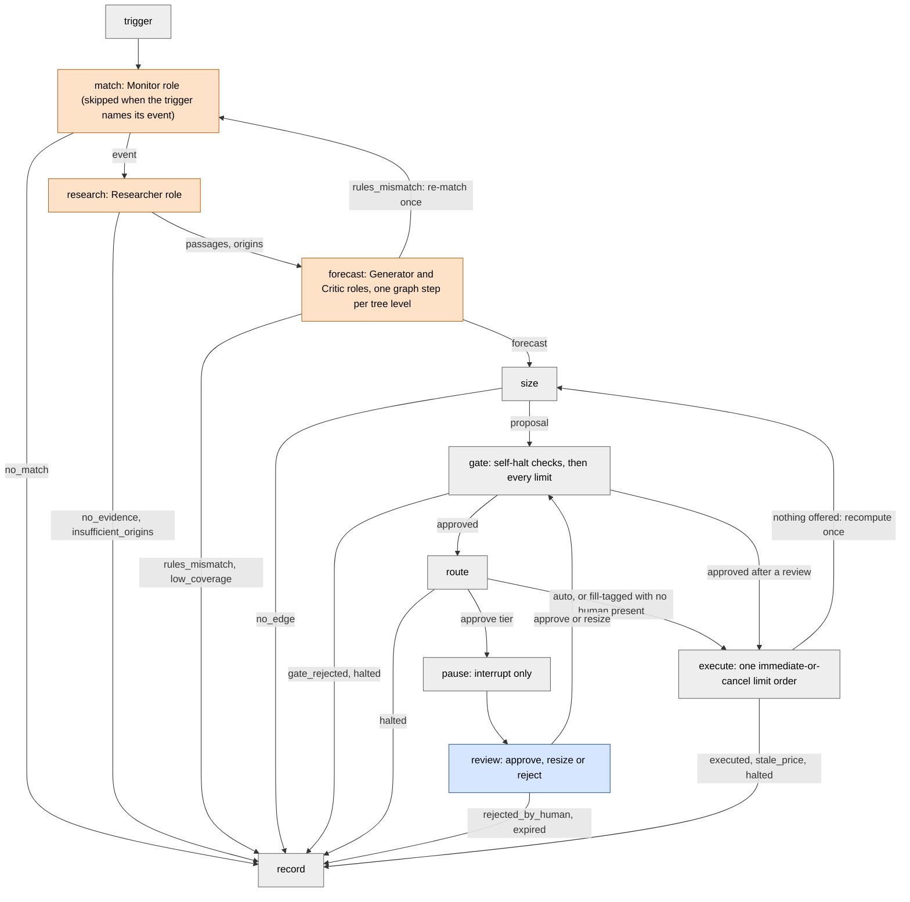
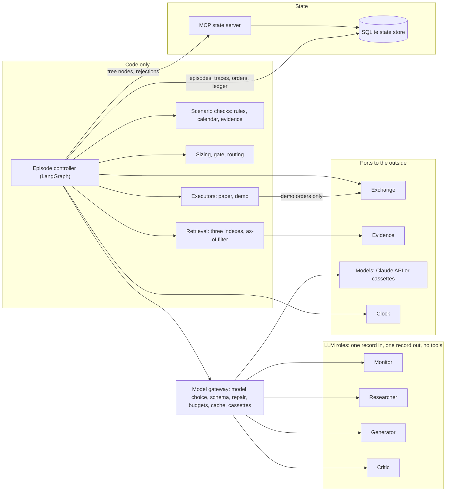

# Architecture

pmfa runs one pipeline, the *episode*, for each trigger: it matches the trigger to an event, gathers
dated evidence, forecasts every market of the event, sizes one order, checks the order against hard
limits, decides who approves it, and records everything. Four LLM roles do the reading and the
judging. Code does everything else: every retrieval, every check, every number that touches money,
and every order. This page shows where that line runs.

Terms in *italics* on first use are defined in the [glossary](glossary.md). Decisions behind the
design are in [decisions/](decisions/README.md); the safety properties are in
[guardrails.md](guardrails.md); the specification is [spec.md](spec.md).

## The episode pipeline

Each box is one node of the LangGraph graph in [graph.py](../src/pmfa/episode/graph.py); the
node bodies are in [pipeline.py](../src/pmfa/episode/pipeline.py). Orange boxes call an LLM role
through the model gateway. Grey boxes are code only. The blue box is the human. Every path ends in
`record`, and every episode ends in exactly one named *exit*, shown on the arrows into `record`.



A thirteenth exit, `error`, can leave from any node: a model answer that fails validation twice, a
budget cap reached outside the tree search, or the run's dollar cap (see [budgets](guardrails.md#budgets-per-episode-and-per-run)).
The graph has three forecast nodes (`forecast_start`, `forecast_step` once per tree level,
`forecast_finish`) so the checkpointer saves the search between levels; the diagram draws them as one
box. `pmfa.episode.mermaid()` prints the exact wiring.

What each step does, in the code's terms:

| Step | Who | What happens | Exits |
| --- | --- | --- | --- |
| trigger | code | Saves a new episode record. The trigger's time becomes the *as-of time*. | |
| match | Monitor, or code | A *new-document* trigger: code searches the events index for the top 5 open events, and the Monitor picks one or none. A *price-move* or *schedule* trigger already names its event, so no model is called. | `no_match` |
| research | Researcher, then code | The Researcher writes one query for and one against. Code retrieves the top 8 passages as of the as-of time; for a price-move trigger, only passages published after the event's last forecast count, so a price move with no new evidence since then ends in `no_evidence`. The Researcher drops passages that do not bear on the event. Code resolves *origins* and applies the origin rule. | `no_evidence`, `insufficient_origins` |
| forecast | Generator, Critic, code | Beam search over a scenario tree ([below](#the-scenario-tree-search)). | `rules_mismatch`, `low_coverage` |
| size | code | Picks the one market and side with the best fee-adjusted *edge* that meets the liquidity floor, sizes it at quarter-Kelly times confidence, and proposes the difference from the current holding. | `no_edge` |
| gate | code | Runs the self-halt conditions, then re-verifies every limit with its own arithmetic. | `gate_rejected`, `halted` |
| route | code | Scores the risk and assigns the *routing tier*: auto, approve or halt. | `halted` |
| pause, review | human | The graph stops and waits ([below](#the-human-approval-pause)). | `rejected_by_human`, `expired` |
| execute | code | Re-reads the book. If nothing is offered at or below the limit price, no order is sent: the episode re-sizes once on fresh books; after that, or after a review, it exits `stale_price`. Otherwise it places one immediate-or-cancel limit order. | `executed`, `stale_price`, `halted` |
| record | code | Writes the forecast and one *ledger* entry per market, and closes the episode record. | |

## The parts: roles, code, gateway, state, ports



- **LLM roles** are prompt and schema definitions in [models/roles/](../src/pmfa/models/roles/).
  A role never calls a tool. It reads one input record from
  [records/roles.py](../src/pmfa/records/roles.py) and returns one output record, which the gateway
  validates. The Critic has three model slots (depth 1, depths 2 and 3, and the fast path).
- **The model gateway** ([gateway.py](../src/pmfa/models/gateway.py)) is the one place a role call
  becomes an API request. It owns the model and effort per slot, native JSON-schema output with one
  repair retry, the call, dollar and seconds caps, the response cache, and cassette recording.
- **Code-only parts** are ordinary functions. The decision core
  ([decision/](../src/pmfa/decision/)) does no I/O and calls no model.
- **The state store** is one SQLite database. The controller writes the roles' shared state (tree
  nodes, critic rejections) through the MCP state server, in process; everything else goes to the
  store directly. A reviewer can attach any MCP client to the same server to browse episodes and
  traces: `python -m pmfa.state --db PATH` (or `pmfa state-server`) serves a database over stdio.
- **Ports** ([ports.py](../src/pmfa/ports.py)) are the only way out: `Exchange` (market data),
  `Executor` (orders and holdings), `Evidence` (documents and the release calendar), `Knowledge`
  (the retrieval indexes), `Models` (the gateway or a stand-in), `Clock`, and `StateStore`. A
  *world* is one implementation of each; a *run mode* is a choice of world.

## The four run modes and what sits behind each port

The pipeline code is identical in every mode. Only what sits behind the ports changes.

| Port | Replay | Backtest | Shadow | Demo |
| --- | --- | --- | --- | --- |
| Exchange | One recorded JSON file ([recorded.py](../src/pmfa/world/recorded.py)) | Frozen snapshot read as of the clock ([snapshot/reader.py](../src/pmfa/world/snapshot/reader.py)) | Kalshi production, public data only, no credentials ([kalshi/production.py](../src/pmfa/world/kalshi/production.py)) | Kalshi demo exchange ([kalshi/demo.py](../src/pmfa/world/kalshi/demo.py)) |
| Evidence | Documents in the recorded file | Frozen corpus read as of the clock ([evidence/corpus.py](../src/pmfa/world/evidence/corpus.py)) | Live Federal Reserve and BLS feeds ([evidence/live.py](../src/pmfa/world/evidence/live.py)) | Live feeds |
| Models | Cassettes ([cassette.py](../src/pmfa/models/cassette.py)) | Claude API through the gateway, with the response cache | Claude API | Claude API |
| Executor | Paper, against the recorded execution-time books | Paper, against a book built from the first one-minute candle after the order arrives | Paper, against the live order book | Demo exchange: real orders, mock funds |
| Who approves | The recorded review, if any | Nobody: approve-tier trades are filled and tagged | Nobody by default (filled and tagged), or a human when review is turned on | A human |
| Clock | Simulated | Simulated | System | System |

**Demo P&L is never evidence.** Kalshi warns that demo prices may not reflect real markets, and its
funds are mock. Demo mode exists to show the execution plumbing and the human oversight working on a
real exchange API. Evidence about forecasting skill comes from backtests (scored against the market
price at the same moment) and from shadow mode (simulated fills against live prices).

The worlds are assembled in [recorded.py](../src/pmfa/world/recorded.py),
[backtest.py](../src/pmfa/world/backtest.py) and [live.py](../src/pmfa/world/live.py). In shadow and
demo mode a foreground loop ([live/loop.py](../src/pmfa/live/loop.py)) repeats one pass: refresh the
indexes, resolve settled outcomes, expire due proposals, apply the self-halt conditions, detect
triggers and run their episodes, and record an equity point. The commands for each mode are in the
README.

## The modules

| Module | What it is |
| --- | --- |
| [records/](../src/pmfa/records/) | Immutable Pydantic records that cross module boundaries: the shared vocabulary. Prices and money are decimals; times are timezone-aware UTC. |
| [ports.py](../src/pmfa/ports.py) | The protocols every world implements, and the `World` that bundles them. |
| [config.py](../src/pmfa/config.py) | One typed configuration with every limit, threshold, source, model slot and followed series. It is validated at load, including that the caps agree with each other. |
| [episode/](../src/pmfa/episode/) | The LangGraph controller: `run(trigger)`, `resume(episode_id, review)`, `expire(episode_id)`, and the trace writer. |
| [world/](../src/pmfa/world/) | Adapters behind the ports: the Kalshi client (signing, fixed-point parsing, pagination, throttling), the snapshot builder and reader, the evidence sources, clocks, and the recorded, backtest and live worlds. |
| [knowledge/](../src/pmfa/knowledge/) | Chunking, embedders, the Chroma indexes with the as-of filter inside every query, origin resolution, and ranking. |
| [state/](../src/pmfa/state/) | The SQLite store, the state service, and its MCP server for either MCP SDK line. |
| [models/](../src/pmfa/models/) | The gateway, the Anthropic backend, the cache, cassettes, scripted models for tests, meters, and the four roles. |
| [forecast/](../src/pmfa/forecast/) | Outcome spaces, tree levels, the code checks, beam search with the protected slot, aggregation, quantile conversion, and the pruning audit. |
| [decision/](../src/pmfa/decision/) | Fees, ticks, sizing, the gate, risk state and routing. Pure functions. |
| [execution/](../src/pmfa/execution/) | The paper executor, the paper portfolio, the review queue, halt, and the stage manager. The demo executor lives with the Kalshi adapters in [world/kalshi/demo.py](../src/pmfa/world/kalshi/demo.py). |
| [evaluation/](../src/pmfa/evaluation/) | The backtest runner, the one-call baselines, the outcome resolver, metrics (Brier score, skill, reliability), the clustered bootstrap, P&L, and the stage benchmarks. |
| [live/](../src/pmfa/live/) | Trigger detection and the foreground loop for shadow and demo mode. |
| [cli/](../src/pmfa/cli/) | The `pmfa` command. |

## The scenario tree search

The forecast engine ([forecast/engine.py](../src/pmfa/forecast/engine.py)) turns one event and its
evidence into one *forecast*: a probability for every market of the event.

**Outcome space.** Code builds the event's mutually exclusive outcomes from its markets
([outcomes.py](../src/pmfa/forecast/outcomes.py)). A Fed decision has five options (hike more than
25 bp, hike 25, hold, cut 25, cut more than 25). A CPI event is a *ladder*: its strike markets cut
the reported number into bins. Every market maps to the outcomes on which it resolves YES, so one
distribution over outcomes gives consistent probabilities for every market.

**Levels.** Each tree depth is one scheduled event ([levels.py](../src/pmfa/forecast/levels.py)):
up to two of the nearest calendar entries between the as-of time and the event's close, then the
event's own resolution, which is always last. Depth is at most 3. An event that closes within 60
minutes takes the *fast path*: the resolution level alone, on the fast-path model slot.

**One level, for each parent** (the root at depth 1, otherwise each expanded scenario above):

1. The Generator proposes up to 3 *scenarios*: claims about the level's event, each citing passage ids.
2. Code checks each one ([checks.py](../src/pmfa/forecast/checks.py)) and deletes it on any failure:
   - *rules*: at the resolution level it asserts outcomes that exist (valid option ids, or a finite
     numeric range); before it, it asserts no resolution outcome;
   - *calendar*: the level's event falls after the as-of time and no later than the close;
   - *evidence*: it cites at least one passage, and every cited passage was supplied, predates the
     as-of time, and belongs to a counted origin.
3. The Critic scores the surviving siblings in one call. It sees the claims and their cited passages,
   never the Generator's rationale. For each scenario it gives a probability given the parent, and
   an outcome distribution if that path holds (option probabilities, or five quantiles for a ladder).
   Code clips sibling probabilities to [0, 1] and scales them down if they sum above 1; the remainder
   is unexplored mass. The Critic may reject a scenario with a reason (stored, and shown to the
   Generator so it is not proposed again) and may ask for more evidence once per scenario, at most 3
   times per episode. Code runs that query, the Researcher filters the results, and the siblings are
   re-scored once.

If every first-level scenario fails the rules check, the episode re-matches once without that event
(new-document triggers only), then exits `rules_mismatch`.

**Choosing the beam.** Each scored scenario has a *path mass* (the product of conditional
probabilities down its path) and an *evidence support* in [0, 1] from the independent origins it
cites and their age ([support.py](../src/pmfa/forecast/support.py)):
`support = min(1, sum of weight x 0.5^(age in days / 30) / 2)`, with weight 2 for a primary origin
and 1 for a secondary one. Scenarios are ranked by path mass times support. When several are within
0.05 of the best remaining score, the one citing more independent origins goes first, then the one
with fresher evidence. The top 3 form the *beam* and are expanded at the next level.

**The protected slot.** For each scenario outside the beam, code re-aggregates the forecast without
it and re-runs sizing. It is a candidate if its removal would flip the trade's direction, change the
trade's cost by more than one *risk unit* (1% of bankroll), or push a tradable market's probability
to exactly 0 or 1. The candidate that moves the size most is expanded as well. Every other scenario
outside the beam is *frozen*: it is not expanded, and it still counts in the forecast with its
probability and its last outcome distribution. At the resolution level every scored scenario is a
leaf.

**Aggregation** ([aggregate.py](../src/pmfa/forecast/aggregate.py)). The forecast is made of every
scored scenario with no scored children: leaves, frozen scenarios, and expanded scenarios whose
children were all deleted or rejected. For each outcome,
`P(outcome) = sum(path mass x scenario's P(outcome)) / total mass`, and a market's probability is the
sum over its outcomes. *Coverage* is the total mass. Below 0.6 the episode exits `low_coverage`.

**Confidence** is `coverage x min(1, independent origins / 3)`, halved when the call budget ran out
during the search. Only origins cited by the scenarios in the forecast count. Confidence multiplies
the Kelly size, so it can only make an order smaller.

**Ladders.** For a ladder, the Critic gives the 5th, 25th, 50th, 75th and 95th percentiles. Code
draws a continuous distribution through them, linear between quantiles, with exponential tails that
carry 5% each and start at the density of the adjacent segment
([quantiles.py](../src/pmfa/forecast/quantiles.py)). Because CPI is reported to 0.1, "above 3.6%"
means an unrounded value of at least 3.65, so every bin edge is shifted up by half the reporting
step. Every bin gets at least 1e-9, so no ladder market is ever exactly 0 or 1, and nested strikes
are always monotone.

### A worked example

A Fed decision event, two calendar entries before the meeting (a CPI release, then a jobs report),
so three levels. The numbers are hand-picked; the beam order and the aggregate were run through the
engine's own functions.

*Depth 1 (CPI release).* The Critic scores A, "CPI comes in hot", at 0.70 and B, "CPI comes in cool",
at 0.25. Unexplored mass is 0.05. Two scenarios fit in a beam of three: both are expanded.

*Depth 2 (jobs report).* Four children are scored:

| Scenario | P(given parent) | Path mass | Support | Origins | Mass x support |
| --- | --- | --- | --- | --- | --- |
| A1 strong jobs | 0.60 | 0.70 x 0.60 = 0.420 | 1.0 | 2 | 0.420 |
| A2 weak jobs | 0.30 | 0.210 | 0.8 | 1 | 0.168 |
| B1 strong jobs | 0.50 | 0.125 | 1.0 | 2 | 0.125 |
| B2 weak jobs | 0.40 | 0.100 | 0.5 | 1 | 0.050 |

A1 is first. Among the rest, A2 (0.168) and B1 (0.125) are within 0.05 of each other, and B1 cites
more independent origins, so B1 goes second and A2 third. The beam is A1, B1, A2. B2 is outside it.
Removing B2 changes neither the trade's direction nor its cost by more than $10 on a $1,000 bankroll,
and moves no market to 0 or 1, so B2 is frozen: it gets no children but keeps its mass, 0.100, and
its distribution (hold 0.30, cut 0.70).

*Depth 3 (resolution).* Each expanded parent gets one leaf: A1a with P = 0.9 (mass 0.378; hold 0.95,
cut 0.05), A2a with P = 0.8 (mass 0.168; hold 0.80, cut 0.20), B1a with P = 1.0 (mass 0.125; hold
0.60, cut 0.40).

*Aggregate.* The forecast is made of A1a, A2a, B1a and the frozen B2.

- Coverage = 0.378 + 0.168 + 0.125 + 0.100 = 0.771, above the 0.6 floor.
- P(hold) = (0.378 x 0.95 + 0.168 x 0.80 + 0.125 x 0.60 + 0.100 x 0.30) / 0.771 = 0.5985 / 0.771 = 0.776.
- P(cut 25) = 0.1725 / 0.771 = 0.224.
- With two independent origins cited, confidence = 0.771 x 2/3 = 0.514.

Dropping the frozen B2 instead of keeping it would give P(cut 25) = 0.1025 / 0.671 = 0.153: the
forecast would drift toward the likeliest path. That is why frozen scenarios stay in.

The search made 6 Generator and 6 Critic calls (1, 2 and 3 parents). A full depth-3 tree makes at
most 9 of each: 1 parent, then the beam plus the protected slot at each of the next two levels.

## From forecast to order: one example

This is the episode test for hawkish Fed minutes (scenario 4 in
[test_scenarios.py](../tests/episodes/test_scenarios.py)), with scripted roles. The forecast gives the
"cut 25 bp" market 0.18 for YES; its YES mid is 0.33; the NO side's best ask is 0.68.

1. **Shrink** toward the market by the category factor 0.5: 0.5 x 0.33 + 0.5 x 0.18 = 0.255 for YES,
   so 0.745 for NO.
2. **Edge** at the ask, with the unrounded taker fee 0.07 x 0.68 x 0.32 = 0.0152 per contract:
   0.745 - 0.68 - 0.0152 = 0.0498, above the 2¢ minimum. NO on this market is the best edge in the event.
3. **Size.** Full Kelly on the fee-inclusive cost c = 0.6952 is (0.745 - c) / (1 - c) = 0.163 of
   bankroll. Quarter-Kelly times confidence 1/3 on $1,000 is $13.61, or 19 whole contracts.
4. **Limit and bound.** The highest price that still keeps a 2¢ edge is 0.71. The order needs only
   the 0.68 level, so the limit is 0.68.
5. **Rounded fee.** 19 contracts cost a fee of $0.2894, rounded up to $0.29. The edge after rounding
   is 0.745 - 0.68 - 0.29/19 = 0.0497, still above 2¢. Cost is 19 x 0.68 + 0.29 = $13.21.
6. **Gate** re-derives all of this and approves. **Route** sends it to the approve tier: the cost is
   above one risk unit ($10), and the category has no calibration record yet.

## The human-approval pause

An approve-tier proposal is decided by a person, possibly in another process and minutes later.

1. `route` saves the proposal as `pending` with its review card, saves the episode as
   `pending_review`, and goes to `pause`.
2. `pause` does one thing: it calls LangGraph's `interrupt()`. The graph's state, plain JSON only, is
   in the checkpointer. In the live modes that is a SQLite file
   (`open_checkpointer(path)` in [controller.py](../src/pmfa/episode/controller.py)). The first
   process can exit.
3. A second process builds an `EpisodeController` over the same state database and checkpoint file
   and calls `resume(episode_id, review)`. The review queue
   ([review.py](../src/pmfa/execution/review.py)) checks the proposal and the decision first. A
   proposal more than 10 minutes old, or whose side's best ask is now above its edge bound, has
   expired: the episode ends `expired` whatever the review says. A resize must shrink the proposal
   and a reject needs a reason code; an invalid review raises and leaves the episode paused.
4. The graph resumes. LangGraph re-runs `pause` from its start; because `pause` has no side
   effect, re-running it is harmless, and `interrupt()` now returns the human's answer.
5. `review` applies the answer (reject ends the episode; resize recomputes fee, cost and edge) and
   sends approve and resize back to `gate`, which runs the self-halt conditions and every check again
   against the book an order would meet now.
6. `execute` is a separate node. It checks the halt flag, re-reads the book, and places the order
   with a deterministic client order id. If an order with that id is already stored for the episode,
   it is not sent again, so a second resume cannot double it.

`expire(episode_id)` ends a paused episode as `expired` without an order. The test
`test_a_pause_in_one_controller_resumes_in_a_second_built_over_the_same_files` in
[test_controller.py](../tests/episodes/test_controller.py) runs the pause and the resume through two
controller objects over the same files.

## What is recorded

For each episode the state database ([state/store.py](../src/pmfa/state/store.py)) holds:

- **The episode record** ([records/episode.py](../src/pmfa/records/episode.py)): trigger, mode,
  as-of time, matched event, exit and its detail, passage ids and origins, forecast, proposal, gate
  result with every check, routing, review, orders with their fills, whether an approve-tier fill
  had no human (`fill_tagged`), model usage (calls, tokens, dollars, seconds), and the full trace.
- **Tree nodes**: every scenario with its claim, cited passages, check results, Critic probability,
  path mass, outcome distribution, evidence support, status (deleted, rejected, expanded, frozen,
  leaf) and the reason for it.
- **Critic rejections** per event, shown to the Generator in later episodes.
- **Proposals and their status history, reviews, orders and fills.** The paper account's balance and
  positions are rebuilt from the stored fills and settlements, and it records an equity point after each order. The daily loss stop and the drawdown halt read these equity points.
- **Ledger entries**: one per market of the forecast event, with the probability, the YES mid at the
  as-of time, whether it traded, its tier, and any override. The outcome and Brier scores are written
  later, when the market resolves.
- **Content hashes** of every cited document, so a later change behind an open position can halt
  the agent.
- **The halt flag and the stage.**

When the gateway records, each episode also gets a cassette: every model call in order, with its
input record, output record, model, effort, tokens, cost and latency.

### Reading a trace

A trace is a numbered list of steps. Each step has the pipeline `node` it belongs to, a `kind`, a
one-line summary, and the records involved as JSON in `data`:

- **thought**: what a role said, its one- or two-sentence rationale, with the call's metadata
  (role, model, effort, tokens, cost, and whether it came from the API, the cache, a cassette or a
  script);
- **action**: what code executed;
- **observation**: what came back.

The trace of the example above:

```text
 1 trigger  observation  new_document trigger trig-fomc-minutes-2026-10 at 2026-11-20T15:00:00+00:00
 2 match    action       search the events index for the top 5 events as of 2026-11-20T15:00:00+00:00
 3 match    observation  1 candidate event(s): KXFEDDECISION-26DEC
 4 match    thought      [Monitor] The trigger bears on KXFEDDECISION-26DEC.
 5 match    observation  matched event KXFEDDECISION-26DEC
 6 research thought      [Researcher] One query for a hold, one for a cut.
 7 research action       retrieve the top 8 passages for two queries as of 2026-11-20T15:00:00+00:00
 8 research observation  2 passage(s) retrieved
 9 research thought      [Researcher] Kept 2 of 2.
10 research observation  kept 2 of 2 passage(s)
11 research action       resolve origins and apply the origin rule
12 research observation  2 independent origin(s), 2 primary
13 forecast action       beam search over 1 level(s); 0 earlier rejection(s), 0 ledger example(s), bankroll $1000
14 forecast action       level 1 of 1: generate, check, and score scenarios for Resolution: Fed decision in Dec 2026?
15 forecast thought      [Generator] Proposed 2 scenario(s): The Committee holds the rate in December; ...
16 forecast thought      [Critic] Scored scored 0.70: ... | scored 0.30: ...
17 forecast observation  level 1: 2 leaf
18 forecast observation  forecast: coverage 1.000, confidence 0.333, depth 1, 1 origin(s)
19 size     action       size the event: confidence 0.333, bankroll $1000
20 size     observation  proposal: buy 19 NO KXFEDDECISION-26DEC-C25 at <= 0.6800, edge 0.0497, cost $13.2100
21 gate     action       check the self-halt conditions
22 gate     action       re-verify every limit
23 gate     observation  approved
24 route    action       score the risk; the YES mid moved 0.0000 since sizing
25 route    observation  tier approve, score 2 (cost_under_risk_unit, category_calibrated)
26 route    observation  no human present (fill_tagged): the approve-tier proposal is filled and tagged
27 execute  action       re-read the NO offers
28 execute  action       place an immediate-or-cancel limit order: buy 19 NO KXFEDDECISION-26DEC-C25 at <= 0.6800
29 execute  observation  filled: 19 of 19 filled, fees $0.29
30 record   observation  exit executed: filled: 19 of 19 at <= 0.6800; 5 ledger entries
```

Read it top to bottom. Thoughts are the only lines a model wrote; everything else is code reporting
what it did. Step 12 shows two origins retrieved, while step 18 counts one: only origins cited by
the scenarios in the forecast count toward confidence. Step 25 names the auto conditions that
failed. Step 26 appears because this test runs with no human present; with a human, the episode
would pause after step 25 and continue with a `review` step. To check a claim against its source,
take the passage ids a scenario cites (in the forecast step's `data`, and on the tree nodes) and
find them in step 8's `data`, which lists every retrieved passage with its source, URL and publish
time.
