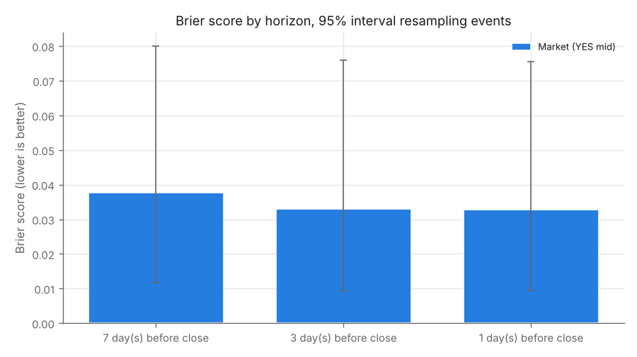
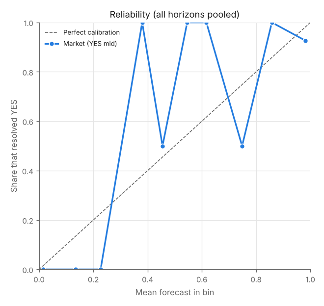
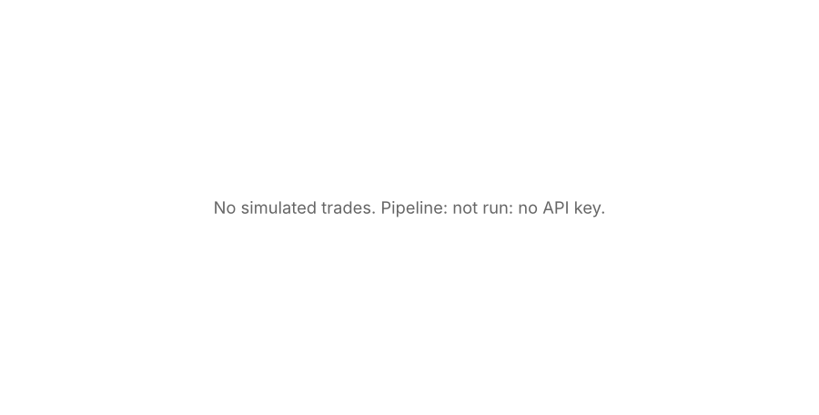

# Backtest report: 2026-11-25-market-baseline

Run status: **complete**. Created 2026-11-25T10:03:46.226217+00:00, finished 2026-11-25T10:03:47.738438+00:00. Every number below comes from this run's `manifest.json` and `metrics.json`; the per-forecast table is `forecasts.csv`.

## What was run and what was not

| System | Status |
|---|---|
| Market (YES mid) | run |
| Prompt only | not run: no API key |
| Single pass (recency and origin ranking) | not run: no API key |
| Single pass (similarity ranking) | not run: no API key |
| Full pipeline | not run: no API key |

The systems marked "not run: no API key" need a model, and no Anthropic API key was available when this run was made. They produced no forecasts, and this report contains no number from them. Only the market's own price was scored.

## Configuration

The full configuration, model assignments, snapshot and corpus manifests, plan and progress are in `manifest.json` in this directory.

- Window: forecasts from 2026-07-01 to 2026-11-25T09:12:38.877766+00:00. The latest listed knowledge cutoff of any assigned model is 2026-06-30.
- Horizons: 7, 3, 1 day(s) before each event's close.
- Bootstrap: 2000 resamples of whole events, seed 20261124, 95% percentile intervals.
- Commit: `9aae03c3e214f1ce89d7940313001109fbe937aa` (working tree had uncommitted changes).
- Snapshot: 7 events, 104 markets, built 2026-11-25T09:32:48.338651Z from external-api.kalshi.com.
- Corpus: 10 from bls.gov, 45 from federalreserve.gov.
- Scoring points: 21; trading triggers: 55.
- Dollar cap for the run: $25.0. Spent on new model calls: $0.0000 (0 new answers, 0 from the cache).

| Slot | Model | Effort | Listed knowledge cutoff |
|---|---|---|---|
| baseline | claude-fable-5-2 | high | 2026-06-30 |
| critic_deep | claude-sonnet-5-5 | high | 2026-06-30 |
| critic_depth1 | claude-fable-5-2 | high | 2026-06-30 |
| fast_path | claude-haiku-5-5 | low | 2026-06-30 |
| generator | claude-haiku-5-5 | medium | 2026-06-30 |
| monitor | claude-haiku-5-5 | low | 2026-06-30 |
| researcher | claude-haiku-5-5 | medium | 2026-06-30 |

## Sample sizes

Markets within one event are correlated (they resolve on the same number), so the event count is the honest sample size and the market count is what a naive reading would claim. Both are shown side by side.

| System | Horizon | Forecasts | Markets answered | Events answered | Abstained |
|---|---|---|---|---|---|
| Market (YES mid) | all | 312 | 104 | 7 | 0 |
| Market (YES mid) | 7d | 104 | 104 | 7 | 0 |
| Market (YES mid) | 3d | 104 | 104 | 7 | 0 |
| Market (YES mid) | 1d | 104 | 104 | 7 | 0 |
| Prompt only | all | not run | not run | not run | not run |
| Single pass (recency and origin ranking) | all | not run | not run | not run | not run |
| Single pass (similarity ranking) | all | not run | not run | not run | not run |
| Full pipeline | all | not run | not run | not run | not run |

## Brier score and Brier skill against the market

The Brier score is the mean of (probability - outcome)^2; lower is better. Brier skill is 1 - system Brier / market Brier on the same rows; above zero beats the market price, below zero is worse than it. Intervals are 95% bootstrap intervals that resample whole events. "Answered" scores only the forecasts a system made; "abstentions as market" scores every abstention as if the system had forecast the market price, so a system cannot flatter itself by abstaining on hard questions. The market compared with itself has skill 0 by definition.

| System | Horizon | Brier (answered) | Market Brier (same rows) | Skill (answered) | Brier (abstentions as market) | Skill (abstentions as market) |
|---|---|---|---|---|---|---|
| Market (YES mid) | all | 0.0345 [0.0108, 0.0773] | 0.0345 | 0.0000 [0.0000, 0.0000] | 0.0345 [0.0108, 0.0773] | 0.0000 [0.0000, 0.0000] |
| Market (YES mid) | 7d | 0.0377 [0.0117, 0.0800] | 0.0377 | 0.0000 [0.0000, 0.0000] | 0.0377 [0.0117, 0.0800] | 0.0000 [0.0000, 0.0000] |
| Market (YES mid) | 3d | 0.0330 [0.0092, 0.0759] | 0.0330 | 0.0000 [0.0000, 0.0000] | 0.0330 [0.0092, 0.0759] | 0.0000 [0.0000, 0.0000] |
| Market (YES mid) | 1d | 0.0328 [0.0095, 0.0755] | 0.0328 | 0.0000 [0.0000, 0.0000] | 0.0328 [0.0095, 0.0755] | 0.0000 [0.0000, 0.0000] |
| Prompt only | all | not run | not run | not run | not run | not run |
| Single pass (recency and origin ranking) | all | not run | not run | not run | not run | not run |
| Single pass (similarity ranking) | all | not run | not run | not run | not run | not run |
| Full pipeline | all | not run | not run | not run | not run | not run |

## How fresh the market price was

The market price at an as-of time is the YES mid of the latest candle at or before that time, or the last trade when one side of the quote is empty (a far strike with no bid). A price's age is measured from the candle it came from: the latest quote for a mid, the latest trade for a last-trade price. One-minute candles exist only for minutes in which a quote or trade changed, so a price can be hours or days old.

| Measure | Value |
|---|---|
| Market prices scored | 312 |
| From the bid-ask mid | 86 |
| From the last trade (one side empty) | 226 |
| Median price age (hours) | 35.5 |
| Share older than 24 hours | 0.542 |
| Oldest price (hours) | 822.5 |

## Reliability

Market (YES mid), answered forecasts, all horizons (expected calibration error 0.0566):

| Bin | Forecasts | Mean forecast | Share YES |
|---|---|---|---|
| [0.0, 0.1) | 185 | 0.015 | 0.000 |
| [0.1, 0.2) | 7 | 0.134 | 0.000 |
| [0.2, 0.3) | 11 | 0.227 | 0.000 |
| [0.3, 0.4) | 1 | 0.380 | 1.000 |
| [0.4, 0.5) | 2 | 0.455 | 0.500 |
| [0.5, 0.6) | 5 | 0.546 | 1.000 |
| [0.6, 0.7) | 3 | 0.617 | 1.000 |
| [0.7, 0.8) | 6 | 0.748 | 0.500 |
| [0.8, 0.9) | 10 | 0.858 | 1.000 |
| [0.9, 1.0) | 82 | 0.981 | 0.927 |

Prompt only: not run.

Single pass (recency and origin ranking): not run.

Single pass (similarity ranking): not run.

Full pipeline: not run.

## Simulated trading after fees

The trading simulation runs the full pipeline on every news trigger. The pipeline was not run: no API key, so there was no trading and no P&L to report.

## Routing tiers

With no human present in a backtest, approve-tier proposals are filled and tagged (fill-tagged). The stage is below autonomous, so even proposals that met every auto condition (would-be-auto) went to the approve tier; they are counted apart from the rest.

No pipeline episode ran, so there are no routing tiers to report.

## Pruning audit

No resolved episode had a scenario tree to audit (the pipeline did not run).

## How each fill was priced

No order was placed (the pipeline did not run). Episodes that ended stale_price because the book was empty: 0.

## How look-ahead was prevented

- The as-of rule is inside the ports: the snapshot exchange shows quotes, listings and results only up to the simulated clock, the frozen evidence port returns only documents published at or before the as-of time, and every retrieval index filters on publish or resolution time inside the Chroma query, before the nearest-neighbour search.
- A canary document dated one day after the end of the window, containing the configured canary text and the words every query uses, sits in the evidence index (not in the corpus). Every retrieval result and every finished episode is checked for it; one hit aborts the run.
- No web access: the exchange is the frozen snapshot, the evidence is the stored corpus, and no port in the backtest world holds an HTTP client.
- The response cache key includes the as-of time, which is part of every role input.
- The run refuses to start if any assigned model's listed knowledge cutoff falls on or after the window start.

In this run the window starts 2026-07-01 and every assigned model lists a knowledge cutoff before it (table above). No retrieval or episode returned the canary; a single hit would have aborted the run.

## Fill assumptions

- Orders are immediate-or-cancel limit orders filled against a book built from one candle: the first one-minute candle after the as-of time plus execution.backtest_latency_seconds, at the period's worst touch (the highest YES ask, or 1 minus the lowest YES bid), with each level holding execution.backtest_volume_share of that candle's volume.
- One-minute candles exist only for minutes in which a quote or trade changed, so when no one-minute candle contains the arrival time the hourly candle is used (coarse), and when none exists, or the candle had no volume, the book is empty and nothing fills.
- The exchange's history has no order-book depth, so liquidity is a candle-volume proxy.
- Taker fees are paid on every fill; the unfilled remainder of an order is dropped.

## Limitations

- **This is a pilot.** The window holds only 7 settled events, a handful per series, and each carries several correlated markets (five per Fed meeting, twenty or more per CPI release). The events, not the markets, are the independent observations, so the intervals are wide and no difference here separates skill from luck.
- The market price is a candle-based mid, sometimes the last trade, and for far strikes it can be stale; markets priced at 0.01 or 0.99 dominate the row count and pull every Brier score toward zero.
- Fills are simulated from candles without depth data; many would use the hourly fallback or meet an empty book. Simulated P&L is not evidence of tradable edge.
- Forecasts at 7, 3 and 1 days before close of the same event are not independent of each other either; the bootstrap keeps an event's rows together across horizons only in the pooled row.

- Not run in this run: Prompt only (not run: no API key); Single pass (recency and origin ranking) (not run: no API key); Single pass (similarity ranking) (not run: no API key); Full pipeline (not run: no API key). Nothing in this report describes how those systems would do.

## Files

- `manifest.json`: configuration, models, window, data manifests, plan, progress.
- `forecasts.csv`: one row per system, market and as-of time, with the abstention note.
- `metrics.json`: every number above.
- `figures/`: the three figures.
- No episode traces were saved (no pipeline episode ran).
