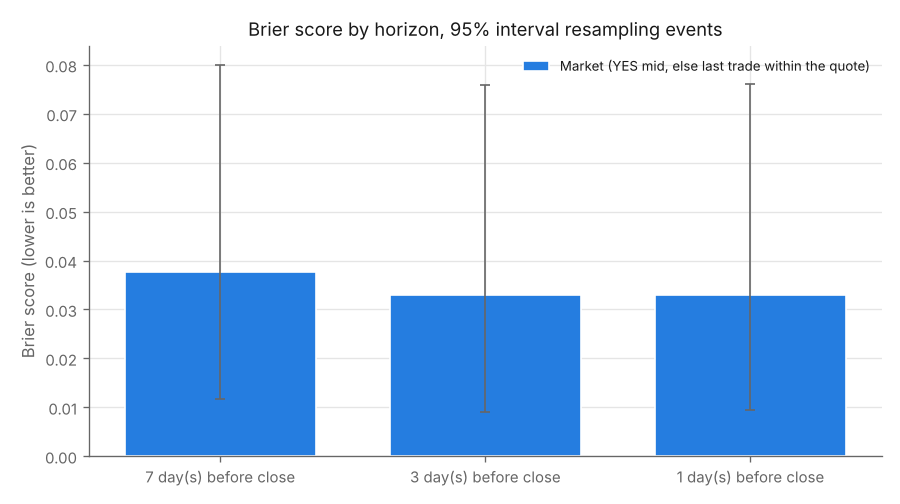
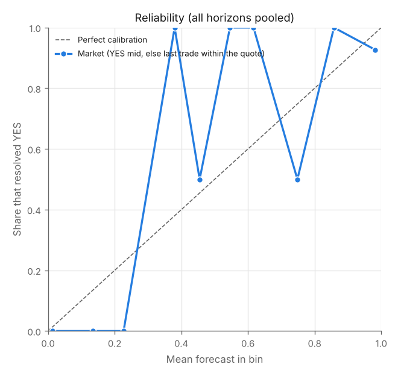
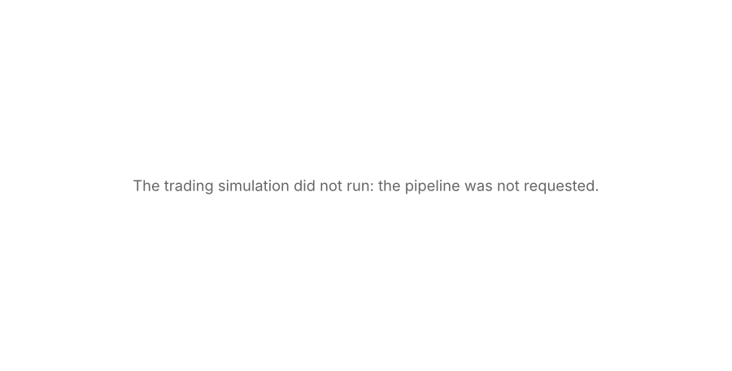

# Backtest report: 2026-11-26-market-baseline

Run status: **complete**. Created 2026-11-26T06:54:00.596722+00:00, finished 2026-11-26T06:54:07.950468+00:00. Every number below comes from this run's `manifest.json` and `metrics.json`; the per-forecast table is `forecasts.csv`.

## What was run and what was not

| System | Status |
|---|---|
| Market (YES mid, else last trade within the quote) | run |
| Prompt only | not requested |
| Single pass (recency and origin ranking) | not requested |
| Single pass (similarity ranking) | not requested |
| Full pipeline | not requested |

## Configuration

The full configuration, model assignments, snapshot and corpus manifests, plan and progress are in `manifest.json` in this directory.

- Window: forecasts from 2026-07-01 to 2026-11-25T20:10:48.937084+00:00. The latest listed knowledge cutoff of any assigned model is 2026-06-30.
- Horizons: 7, 3, 1 day(s) before each event's close.
- Bootstrap: 2000 resamples of whole events, seed 20261124, 95% percentile intervals.
- Commit: `77f5f73c704b4573b5c9afe140092b66e7549abf`.
- Data: snapshot content SHA-256 `15d471e2b2b6700e7bb137355c241c65df1d67ff0cca68fd2355464682992638` (the same for any rebuild that holds the same rows), snapshot file SHA-256 `a9c3334dc0536a4eedecd0fc2b0e75bcee310db34e7031ea2c7ec16901d4ebf4` (this exact file; differs on every rebuild), corpus texts digest `22e5b3662f30374118637a09def8b0fc9a5bd70ed60bd6a85bee7975e6f46d75`.
- Snapshot: 7 events, 104 markets, built 2026-11-25T20:10:52.303544Z from external-api.kalshi.com.
- Corpus: 10 from bls.gov, 45 from federalreserve.gov.
- Scoring points: 21; trading triggers: 55.
- Dollar cap for the run: $25. Spent on new model calls: $0.0000 (0 new answers, 0 from the cache).

| Slot | Model | Effort | Listed knowledge cutoff |
|---|---|---|---|
| baseline | claude-fable-5-2 | high | 2026-06-30 |
| critic_deep | claude-sonnet-5-5 | high | 2026-06-30 |
| critic_depth1 | claude-fable-5-2 | high | 2026-06-30 |
| fast_path | claude-haiku-5-5 | low | 2026-06-30 |
| generator | claude-haiku-5-5 | medium | 2026-06-30 |
| monitor | claude-haiku-5-5 | low | 2026-06-30 |
| researcher | claude-haiku-5-5 | medium | 2026-06-30 |

## Left out of scoring

The release calendar has 1 release(s) in the window with no event of the followed series in the snapshot, so nothing was scored for them. The exchange does not list an event for every release.

- cpi_release:2026-10 (Consumer Price Index for October 2026, 2026-11-10T13:30:00+00:00): no KXCPIYOY event in the snapshot. So the exchange listed no KXCPIYOY event for this release: none of the 2 KXCPIYOY event(s) the builder dropped closes within two days of it.

Events the exchange listed that the snapshot builder did not store (12):

- KXCPIYOY-26DEC: closes 2027-01-13T13:29:00+00:00, after the end of the window 2026-07-01T00:00:00+00:00 to 2026-11-25T20:10:48.937084+00:00
- KXCPIYOY-26NOV: closes 2026-12-10T13:29:00+00:00, after the end of the window 2026-07-01T00:00:00+00:00 to 2026-11-25T20:10:48.937084+00:00
- KXFEDDECISION-26DEC: closes 2026-12-09T18:59:00+00:00, after the end of the window 2026-07-01T00:00:00+00:00 to 2026-11-25T20:10:48.937084+00:00
- KXFEDDECISION-27APR: closes 2027-04-28T17:59:00+00:00, after the end of the window 2026-07-01T00:00:00+00:00 to 2026-11-25T20:10:48.937084+00:00
- KXFEDDECISION-27DEC: closes 2027-12-08T18:59:00+00:00, after the end of the window 2026-07-01T00:00:00+00:00 to 2026-11-25T20:10:48.937084+00:00
- KXFEDDECISION-27JAN: closes 2027-01-27T18:59:00+00:00, after the end of the window 2026-07-01T00:00:00+00:00 to 2026-11-25T20:10:48.937084+00:00
- KXFEDDECISION-27JUL: closes 2027-07-28T17:59:00+00:00, after the end of the window 2026-07-01T00:00:00+00:00 to 2026-11-25T20:10:48.937084+00:00
- KXFEDDECISION-27JUN: closes 2027-06-09T17:59:00+00:00, after the end of the window 2026-07-01T00:00:00+00:00 to 2026-11-25T20:10:48.937084+00:00
- KXFEDDECISION-27MAR: closes 2027-03-17T17:59:00+00:00, after the end of the window 2026-07-01T00:00:00+00:00 to 2026-11-25T20:10:48.937084+00:00
- KXFEDDECISION-27OCT: closes 2027-10-27T17:59:00+00:00, after the end of the window 2026-07-01T00:00:00+00:00 to 2026-11-25T20:10:48.937084+00:00
- KXFEDDECISION-27SEP: closes 2027-09-15T17:59:00+00:00, after the end of the window 2026-07-01T00:00:00+00:00 to 2026-11-25T20:10:48.937084+00:00
- KXFEDDECISION-28JAN: closes 2028-01-26T18:59:00+00:00, after the end of the window 2026-07-01T00:00:00+00:00 to 2026-11-25T20:10:48.937084+00:00

## Sample sizes

Markets within one event are correlated (they resolve on the same number), so the event count is the honest sample size and the market count is what a naive reading would claim. Both are shown side by side.

| System | Horizon | Forecasts | Markets answered | Events answered | Abstained |
|---|---|---|---|---|---|
| Market (YES mid, else last trade within the quote) | all | 312 | 104 | 7 | 0 |
| Market (YES mid, else last trade within the quote) | 7d | 104 | 104 | 7 | 0 |
| Market (YES mid, else last trade within the quote) | 3d | 104 | 104 | 7 | 0 |
| Market (YES mid, else last trade within the quote) | 1d | 104 | 104 | 7 | 0 |
| Prompt only | all | not run | not run | not run | not run |
| Single pass (recency and origin ranking) | all | not run | not run | not run | not run |
| Single pass (similarity ranking) | all | not run | not run | not run | not run |
| Full pipeline | all | not run | not run | not run | not run |

## Brier score and Brier skill against the market

The Brier score is the mean of (probability - outcome)^2; lower is better. Brier skill is 1 - system Brier / market Brier on the same rows; above zero beats the market price, below zero is worse than it. Intervals are 95% bootstrap intervals that resample whole events. "Answered" scores only the forecasts a system made; "abstentions as market" scores every abstention as if the system had forecast the market price, so a system cannot flatter itself by abstaining on hard questions. The market compared with itself has skill 0 by definition.

| System | Horizon | Brier (answered) | Market Brier (same rows) | Skill (answered) | Brier (abstentions as market) | Skill (abstentions as market) |
|---|---|---|---|---|---|---|
| Market (YES mid, else last trade within the quote) | all | 0.0345 [0.0107, 0.0775] | 0.0345 | 0.0000 [0.0000, 0.0000] | 0.0345 [0.0107, 0.0775] | 0.0000 [0.0000, 0.0000] |
| Market (YES mid, else last trade within the quote) | 7d | 0.0376 [0.0116, 0.0799] | 0.0376 | 0.0000 [0.0000, 0.0000] | 0.0376 [0.0116, 0.0799] | 0.0000 [0.0000, 0.0000] |
| Market (YES mid, else last trade within the quote) | 3d | 0.0330 [0.0091, 0.0759] | 0.0330 | 0.0000 [0.0000, 0.0000] | 0.0330 [0.0091, 0.0759] | 0.0000 [0.0000, 0.0000] |
| Market (YES mid, else last trade within the quote) | 1d | 0.0329 [0.0095, 0.0760] | 0.0329 | 0.0000 [0.0000, 0.0000] | 0.0329 [0.0095, 0.0760] | 0.0000 [0.0000, 0.0000] |
| Prompt only | all | not run | not run | not run | not run | not run |
| Single pass (recency and origin ranking) | all | not run | not run | not run | not run | not run |
| Single pass (similarity ranking) | all | not run | not run | not run | not run | not run |
| Full pipeline | all | not run | not run | not run | not run | not run |

## Where the error comes from

Each system's summed squared error, (probability - outcome)^2 added over the rows of its pooled Brier score (answered forecasts, all horizons), split by the forecast probability and by event and market. When one event carries a large share, a comparison on this sample rests heavily on that event; the event-clustered interval above already reflects it.

Market (YES mid, else last trade within the quote): summed squared error 10.7661 over 312 row(s).

| Forecast probability | Rows | Squared error | Share of the error |
|---|---|---|---|
| below 0.10 | 185 | 0.0562 | 0.5% |
| 0.10 to 0.90 | 45 | 4.9107 | 45.6% |
| above 0.90 | 82 | 5.7992 | 53.9% |

The event with the largest share is KXCPIYOY-26JUN: 69.5% of the error, from 63 row(s). The markets with the largest shares: KXCPIYOY-26JUN-T3.5 26.9% (3 row(s)); KXCPIYOY-26JUN-T3.6 26.5% (3 row(s)); KXCPIYOY-26JUN-T3.7 14.2% (3 row(s)).

## Where the market price came from

The market price at an as-of time is the YES mid when both sides are quoted, else the last trade clamped into the standing quote, read from the latest candle at or before that time. One-minute candles exist only for minutes in which the quote or a trade changed, so the quote's age below is the time since it last changed, not a sign that it had lapsed: a quote that stands unchanged is still the market's quote. The last trade's age is shown apart, for the prices that used it; an old trade outside the standing quote is clamped to the quote.

| Measure | Value |
|---|---|
| Market prices scored | 312 |
| From the bid-ask mid (both sides quoted) | 86 |
| From the last trade (one side of the quote empty) | 226 |
| of which clamped into the standing quote | 18 |
| Quote age, median (hours since it last changed) | 0.5 |
| Quote age, largest (hours) | 197.5 |
| Last-trade age, median (hours, last-trade prices) | 60.5 |
| Last-trade age, largest (hours) | 822.5 |
| Last trades older than 24 hours (share of last-trade prices) | 0.748 |

## Reliability

Market (YES mid, else last trade within the quote), answered forecasts, all horizons (expected calibration error 0.0559):

| Bin | Forecasts | Mean forecast | Share YES |
|---|---|---|---|
| [0.0, 0.1) | 185 | 0.013 | 0.000 |
| [0.1, 0.2) | 7 | 0.134 | 0.000 |
| [0.2, 0.3) | 11 | 0.227 | 0.000 |
| [0.3, 0.4) | 1 | 0.380 | 1.000 |
| [0.4, 0.5) | 2 | 0.455 | 0.500 |
| [0.5, 0.6) | 5 | 0.546 | 1.000 |
| [0.6, 0.7) | 3 | 0.617 | 1.000 |
| [0.7, 0.8) | 6 | 0.748 | 0.500 |
| [0.8, 0.9) | 10 | 0.858 | 1.000 |
| [0.9, 1.0) | 82 | 0.982 | 0.927 |

Prompt only: not run.

Single pass (recency and origin ranking): not run.

Single pass (similarity ranking): not run.

Full pipeline: not run.

## Simulated trading after fees

The trading simulation runs the full pipeline on every news trigger. It did not run in this run (the pipeline was not requested), so there is no trading and no P&L to report.

## Routing tiers

With no human present in a backtest, approve-tier proposals are filled and tagged (fill-tagged). The stage is below autonomous, so even proposals that met every auto condition (would-be-auto) went to the approve tier; they are counted apart from the rest.

No pipeline episode ran, so there are no routing tiers to report.

## Pruning audit

No resolved episode had a scenario tree to audit (the pipeline did not run).

## How each fill was priced

No order was placed (the pipeline did not run). Episodes that ended stale_price because the as-of book offered nothing at or below the limit: 0.

## How look-ahead was prevented

The controls the harness puts in place whenever the systems that read evidence run:

- The as-of rule is inside the ports: the snapshot exchange shows quotes, listings and results only up to the simulated clock, the frozen evidence port returns only documents published at or before the as-of time, and every retrieval index filters on publish or resolution time inside the Chroma query, before the nearest-neighbour search.
- A canary document dated one day after the end of the window, containing the configured canary text and the words every query uses, sits in the evidence index (not in the corpus). Every retrieval result and every finished episode is checked for it; one hit aborts the run.
- Every decision in a backtest episode (the price re-read before sending, the one recompute, the second gate, routing's price move) reads the order book as of the as-of time; only the paper fill is priced from a later candle (see Fill assumptions), and no role or decision sees that book.
- A paper fill is timed at the end of the candle that priced it, not at the as-of time. The paper account's balance and positions, the equity points and the stops that read orders (fill failures, a changed source) count an order only from that time, so no decision made before it sees the order's price or outcome.
- In the trading pass the next episode starts no earlier than the latest order's outcome time, so an episode can start later than its trigger, with that later time as its as-of time; the report counts these late starts. The scoring pass keeps its fixed as-of times and relies on that time filter.
- No web access: the exchange is the frozen snapshot, the evidence is the stored corpus, and no port in the backtest world holds an HTTP client.
- The response cache key includes the as-of time, which is part of every role input.
- The run refuses to start if any assigned model's listed knowledge cutoff falls on or after the window start.

In this run the window starts 2026-07-01 and every assigned model lists a knowledge cutoff before it (table above). No system in this run reads evidence, so no evidence index was built and no retrieval was made: the canary was not exercised, and the retrieval controls above did not come into play. The market's price is read from the snapshot as of each as-of time.

## Fill assumptions

- In a backtest every decision (the price re-read before sending, the one recompute, the second gate, routing's price move) reads the order book as of the as-of time. Only the fill is priced from the first one-minute candle after the as-of time plus execution.backtest_latency_seconds (the candle whose period holds that arrival time).
- A fill is timed at the end of the candle that priced it: up to a minute after the arrival time on one-minute candles, up to an hour on the hourly fallback. An order that meets no candle has its outcome timed at the end of the hour searched, or at the arrival time when the market had closed by then. The paper account, the equity points and the stops that read orders count an order only from that time.
- In the trading pass the next episode starts no earlier than that time, so an episode can start later than its trigger (the report counts these). The scoring pass keeps its fixed as-of times and relies on that time filter.
- The immediate-or-cancel limit order fills against a book built from that candle on the conservative side of its period: buying YES meets its highest YES ask, buying NO meets 1 minus its lowest YES bid. Each side holds execution.backtest_volume_share of the candle's volume, floored to whole contracts; a limit that book does not meet fills nothing.
- One-minute candles exist only for minutes in which a quote or trade changed, so when no one-minute candle holds the arrival time the hourly candle holding it is used, and that order is flagged coarse (see How each fill was priced). When neither exists, the market has closed by the arrival time, or the candle had no volume, the book is empty and nothing fills.
- The exchange's history has no order-book depth, so liquidity is a candle-volume proxy.
- Taker fees are paid on every fill, rounded up to the cent once per order; the unfilled remainder of an order is dropped.

## Limitations

- **This is a pilot.** Scoring covered only 7 settled event(s) (4 KXCPIYOY, 3 KXFEDDECISION); 1 release(s) in the window had no event in the snapshot (see Left out of scoring). That is a handful per series, and each carries several correlated markets (five per Fed meeting, twenty or more per CPI release). The events, not the markets, are the independent observations, so the intervals are wide and no difference here separates skill from luck.
- The market price is the YES mid when both sides are quoted, else the last trade clamped into the standing quote, read from candles. Far strikes often have one side of the quote empty, so their price is a last trade (kept inside the standing quote); markets priced at 0.01 or 0.99 dominate the row count and pull every Brier score toward zero.
- Fills are simulated from candles without depth data, some from the coarse hourly fallback or against an empty book (counted under How each fill was priced). Simulated P&L is not evidence of tradable edge.
- Forecasts at 7, 3 and 1 days before close of the same event are not independent of each other either; the bootstrap keeps an event's rows together across horizons only in the pooled row.

- Not run in this run: Prompt only (not requested); Single pass (recency and origin ranking) (not requested); Single pass (similarity ranking) (not requested); Full pipeline (not requested). Nothing in this report describes how those systems would do.

## Files

- `manifest.json`: configuration, models, window, data manifests, plan, progress.
- `forecasts.csv`: one row per system, market and as-of time, with the abstention note.
- `metrics.json`: every number above.
- `figures/`: the three figures.
- No episode traces were saved (no pipeline episode ran).
